# Route Logistics — Customer-to-Payment Workflow Audit

**Audit date:** November 16, 2026, America/Los_Angeles.

**Source baseline:** `83c1262db0408362acb1dddd64b34e3d1c0238f3`, existing `main`.

**Infrastructure:** existing Firebase project `mi-factotum-field-service` and production Netlify site.

**Original audit scope:** source inspection, read-only deployed metadata, existing local/emulator tests and implementation planning. No application features, runtime configuration or financial records were changed during that audit. No provider transactions, real email/SMS, live Stripe activation, QuickBooks writes or deployments were performed during the audit.

**Batch B release addendum, November 16, 2026:** **G05–G09 are resolved for the bounded technician-estimate and secure-link workflow** by implementation `8af151adcbc4e2573e99ba4ec306103a03d8e596`. [Technician estimates and customer approval](TECHNICIAN_ESTIMATES_AND_CUSTOMER_APPROVAL.md) records the reachable assigned-visit editor, narrow technician capability, owner-controlled direct delivery, project/user/company/membership/role-scoped offline drafts and photos, exact-version management review, customer approve/decline/revision decisions and explicit scheduling-needed handoff. Drafting/review/decision creates no job, invoice, payment or accounting write. Historical quote discovery inside the OTP portal remains a separately documented limitation. `rlEstimate` revision `rlestimate-00015-qib` and `rlEstimateApproval` revision `rlestimateapproval-00007-yes` are active; no other Function/rule/index was deployed. Netlify deployment `6afbb76afbdc8c884804f099` is ready for the same commit and its served assets passed read-only feature checks. Automated local evidence passed 14/14 focused estimate emulator cases, 423/423 complete mobile cases, 475/475 web cases, the 135-execution browser matrix plus corrected 5/5 focused rerun, clean web lint/build and native/export checks recorded in the release report. Physical Android/iOS restart, manager/customer device flows and a real authorized synthetic email remain unpassed until performed.

**Batch A release addendum, November 16, 1:19 PM Pacific:** **G01–G04 are resolved for the bounded implementation** in `cd6dcabec37075de63c225a6860e439498db6eec`. [Prospect intake and estimate scheduling](PROSPECT_INTAKE_AND_ESTIMATE_SCHEDULING.md) records duplicate-aware reuse, lifecycle, stable properties, follow-up, checked nonbillable estimate visits and mobile outcomes. Seven affected Functions, tested rules and two READY inquiry indexes are deployed. Web publication `00b0471` is ready in Netlify `6afb731d2c8e0cac2e90a9ea`; served assets were verified. Separate executed suites passed **564** broader emulator cases, **129** final focused, **452** web, **417** mobile and **42** browser executions across three engines; counts overlap. Expo Doctor **18/18**, both native JS exports and local Android build passed. All production baseline hashes/counts and financial gates remain unchanged. Operator scenarios/new native installation remain separate; technician quote preparation/delivery and other gaps are not closed by Batch A.

**November 16 repair addendum, verified 12:10 PM Pacific:** **G12, G13 and G14 are resolved** by implementation `4821a11b682e79c1c0586ba89257dde0c7ea06d0`. The server-authoritative invoice contract preserves approved quote terms, atomically prevents duplicate bills, and enforces financial authorization/revisions. Four affected Route Logistics Functions and the narrow invoice rules change are deployed. Web publication `47cf3c2` is ready in Netlify deployment `6afb6298f174af9dbe74c0cb`; corrected served assets were verified. [Invoice integrity repair](INVOICE_INTEGRITY_REPAIR.md) records source, tests, deployed revisions, historical compatibility and remaining acceptance. Separate executed suites passed 528/528 full emulator cases, 29/29 final invoice cases, 437/437 web cases and 36/36 browser smoke executions across three engines; counts overlap. No real financial/provider operation or historical repair was performed. All baseline record metadata remained unchanged, Stripe remains test-only, QB writes remain disabled and its processor remains PAUSED. Other findings and original line-number references below remain a dated audit baseline unless explicitly updated.

## 1. Executive summary

The lifecycle is **partially integrated**, with substantial reusable operational, quotation, authorization and test-payment foundations. It is **not ready to be described as a complete commercial customer-to-payment workflow**.

The strongest existing paths are company customer management, checked scheduling/assignment, assigned mobile fieldwork, versioned online management estimates, private photo/PDF delivery, expiring customer approval links, idempotent quote-to-job conversion, secure web Stripe test payments and an optional tenant-isolated QuickBooks sandbox connector.

The original audit identified three priority billing defects, now resolved by the repair above:

1. **Approved quote value could be lost.** Conversion wrote job `total`/`estimatedCost`; invoicing read only `totalCost`. Executing the original invoice service with an in-memory database boundary produced a **$0 invoice from a $108.25 converted job**, dropping approved quote lines/tax.
2. **Concurrent invoice creation could duplicate billing.** The original query-then-add path produced **two invoices for one job** in an isolated concurrency probe.
3. **Native invoice creation lacked server authority.** Client arithmetic and invoice fields were constrained by rules, but the server did not recompute invoice lines/taxes or transactionally verify completed-job/customer references and revision transitions. This was a financial correctness gap for an authorized finance actor, not evidence of technician or cross-tenant financial access.

Batch A implements prospect/inquiry tracking, duplicate-aware reuse, multiple properties and assigned estimate visits. Important remaining links are assigned-technician quote permissions and durable quote drafts, customer decline/revision requests, approved-quote scheduling-needed follow-up, native partial/deposit allocations, technician-assisted payments and native-payment-to-QuickBooks export. The company mobile navigation does **not** expose its retained quote editor; component existence/tests do not establish reachable company quoting functionality.

Read-only production checks at **11:15 AM Pacific** confirmed all **99 source-exported functions ACTIVE**, deployed Stripe **test mode** with live approval false, QuickBooks **sandbox** with writes and production approval false, enabled estimate/email flags, and a connected sandbox metadata record. The **Route Logistics QuickBooks event processor schedule is PAUSED**. These settings were preserved. Access-token expiry is expected to invoke existing refresh logic; it is not by itself a broken connection.

Recommended sequence: retain the requested A→E business progression and reuse existing quote/payment implementations. The mandatory G12–G14 implementation gate is now satisfied; remaining financial policy, operator and provider acceptance gates still apply before a billing/payment pilot. A first prospect-to-estimate-visit batch can proceed independently of live payments or QuickBooks.

**Classification:** Complete means an inspected, bounded implementation supported by meaningful automated evidence; it does not imply physical-device or real-provider acceptance. Partial means a necessary workflow/surface/acceptance step remains. Missing means no working path was found. Blocked means external configuration, approval or provider/operator acceptance is required. These distinctions apply to every table below.

## 2. End-to-end lifecycle diagram

```mermaid
flowchart LR
  A[Tenant inquiry and follow-up queue] --> B[Reuse customer or explicit prospect and service property]
  B --> C[Assigned nonbillable estimate visit and outcome]
  C --> D[Assigned technician durable quote and exact-version management review]
  D --> E[Private versioned PDF/email and customer approval]
  E --> F[Authorized explicit conversion and checked scheduling]
  F --> G[Assigned job and mobile service completion]
  G --> H[Reviewed server invoice: approved terms and atomic identity]
  H --> I[Customer web Payment Element: test mode]
  I --> J[Native Stripe reconciliation: test fields only]
  H -. reviewed optional export .-> K[QuickBooks sandbox invoice]
  K -. signed inbound events; worker paused .-> L[QB balance/payment reconciliation]
  J -. missing native payment export .-> K
```

Approval does not automatically schedule a visit or charge a customer. Estimate visits and service jobs currently lack a business-kind discriminator. Scheduled stop order is not an actual driving path.

## 3. Capability matrix

| Lifecycle stage | Classification | Current UI/backend/data | Platform and actor scope | Evidence and principal limitation | Priority |
| --- | --- | --- | --- | --- | --- |
| New inquiry | Implemented bounded internal workflow | Customers → New Inquiry, `rlManageInquiry`, private inquiry/follow-up queue | Owner/admin/manager web; no new public request intake | Contact reuse/separate decision, source/service/property, follow-up and revision history; deployed/automated evidence in Batch A report | A; G01 resolved |
| Prospect | Implemented bounded workflow | Existing `customers` lifecycle + separate archive, normalized duplicate review, stable embedded properties | Management web; mobile uses assigned property snapshot | Same-ID activation, no auto merge or historical reclassification; bounded directory limits documented | A; G01–G03 resolved |
| Estimate appointment | Implemented; native physical acceptance pending | Existing `jobs` with `appointmentKind`, free/nonbillable guard, inquiry/property IDs and outcome | Management web scheduling; normal Field/Management mobile schedules | Existing availability/locks/evidence queues reused; completed visits now hand off to the Batch B quote workflow | A; G04 |
| On-site estimate | Complete bounded implementation; physical native acceptance pending | Assigned Field action, durable mobile draft/private photos, `rlEstimate`, immutable versions and review task | Assigned technician mobile; owner/admin/manager web/mobile review | Narrow live-assignment capability, owner direct-send gate and version conflicts tested; real device restart remains unpassed | B; G05–G07 resolved |
| Customer approval | Complete bounded secure-link decisions; portal history separate | `/estimate-approval`, versioned PDF, approve/decline/revision, hashed expiring version-bound token and scheduling task | Customer needs no staff account; responsive web; management follow-up | Secure decision/replay/recipient tests pass; OTP portal quote history and physical customer-device acceptance remain | B; G08–G09 resolved |
| Scheduled job | Complete bounded internal contract | `rlManageJob`, `rlCheckAvailability`, `jobs`, locks/availability/service areas | Management web; assigned field/mobile management visibility | Tests cover conflicts/tenant scope; no customer self-booking, travel-time scheduling or recurring quote conversion | Existing foundation; G10 |
| Completed service | Partial acceptance | Existing work-order/notes/photo/checklist/visit/offline operation workflow | Assigned technicians; authorized owners/managers doing fieldwork | Current note repair has automated/install evidence; physical offline restart/sync remains separately unaccepted | Preserve; G11 |
| Invoice | Integrity repaired; wider billing workflow Partial | Jobs → review/confirm, `/invoices`, authoritative `rlManageInvoice` | Owner/admin/authorized solo owner; manager/technician excluded | G12–G14 resolved; partial/deposit ledger and later billing features remain absent | C; G15–G17 |
| Payment | Partial; live Blocked intentionally | Portal/staff web Stripe Elements Payment Element, signed webhook, private payment/event rows | Customer scoped invoice; owner/admin finance | Full-invoice test collection only; no technician UI, partial/deposit ledger or provider merchant routing | D; G16–G20 |
| Accounting reconciliation | Partial; automatic processing Blocked by paused schedule | Optional QuickBooks OAuth/mappings/reviewed sandbox export/inbound reconciliation | Owner config/exports; owner/admin read/reconcile | Writes disabled; processor paused; native payment/refund export and tax UI missing; genuine routed delivery unaccepted | C/D; G21–G23 |
| Daily technician report | Partial underlying data; assembled report Missing | Jobs, visit evidence, shift events, latest position, saved route order | Management web/mobile operations views | No joined per-person/day report/export; no raw historic GPS path | E; G25–G26 |

The enabled staff roles are **owner, admin, manager and technician**. “Dispatcher” describes an owner/manager/admin operational function; `reservedProfiles.dispatcher.enabled` is false. Platform administration is separate from these company roles.

## 4. Current architecture and data relationships

Web is React/Vite; mobile is Expo/React Native. Both use the existing Firebase project. Tenant callables validate verified authentication/current membership; scoped queries poll with TanStack Query without reloading the page. Mobile has workspace-scoped local caches and durable queues for supported field operations, not every feature.

| Records | Relationship and purpose |
| --- | --- |
| `companies`, `teamMembers`, `users` | Owner, active company membership/role and workspace identity. A role claim alone is insufficient for protected callables. |
| `customers` | Tenant contact/lifecycle, separate archive state, saved address plus stable embedded service-property directory; existing IDs reused by jobs/invoices/estimates. |
| `rlInquiries`, `rlIntakeOperations`, `rlCustomerIdentityLocks` | Private per-request follow-up/history, stable replay receipts and normalized tenant identity serialization. No second customer database. |
| `jobs`, `servicePlans`, `rlScheduleLocks`, `rlStaffAvailability` | Customer/property snapshot, assigned membership/UID, schedule/status/instructions/work notes, recurring source, checked scheduling and field eligibility. |
| `estimates`, `rlEstimateVersions`, `rlEstimateOperations`, `rlEstimateApprovalSecrets`, `rlEstimateConversions` | Quote header/customer or recipient, immutable priced/versioned terms, replay IDs, private approval token/version state and deterministic conversion relationship. |
| `photos`, `serviceLogs`, service-form records, `rlJobVisits`, `rlOperations` | Job-linked private photos, application/service records, arrival/departure/access evidence and durable replay receipts. |
| `invoices` | Server-controlled native invoice lines/tax/cents/total/status/revision + canonical `jobId`/`customerId` and approved-estimate linkage where applicable; legacy values preserved. |
| `rlInvoiceClaims`, `rlInvoiceOperations`, `rlInvoiceAudit` | Private transactional workspace/job identity, stable replay receipts and revision/action evidence; direct client access denied. |
| `rlPayments`, `rlPaymentEvents` | Private invoice/mode→Stripe attempt and deduplicated provider events. Test reconciliation uses `testPaymentStatus`, not real invoice settlement. |
| `rlMail`, notification/push/SMS outboxes | Existing asynchronous delivery, consent/gates, retries and history. Enqueued/sent/provider-delivered/inbox are separate states. |
| `rlQuickBooksConnections`, `rlQbRealms`, `rlQbMappings`, `rlQbRemoteMappings` | Private tenant/environment grant + realm routing, native→provider IDs and remote uniqueness registry. |
| `rlQbOperations`, `rlQbWebhookEvents`, `rlQbReconciliations`, `rlQbPaymentMappings` | Reviewed export attempts, signed deduplicated inbound events, reconciliation receipts and inbound payment allocations; not a native unified payment ledger. |
| `rlPortalChallenges`, `rlPortalDocuments` | Hashed OTP challenge; explicitly published customer files. Provider associations are resolved from current active customer email/scope, not a universal cross-provider customer database. |
| `rlWorkShifts`, `rlWorkShiftEvents`, `rlLocations`, `rlRoutes` | Current shift, historical start/end events, latest expiring position and planned stop order. No raw GPS trail store was found. |

### Deployed state checked during this audit

| Check | Observed read-only result |
| --- | --- |
| Production web | Netlify deploy `6afb54f0c630d545e8e750a8`, commit `83c1262…`, ready; site and entry asset HTTP 200. |
| Source-exported Functions | 99/99 ACTIVE. This proves deployment presence/state, not a byte-for-byte source-build attestation or provider success. |
| Estimates/forms/email | `RL_ESTIMATES_ENABLED=true`, `RL_ESTIMATE_EMAIL_ENABLED=true`, `RL_SERVICE_FORMS_ENABLED=true`, `RL_EMAIL_ENABLED=true`. |
| Stripe backend | `RL_STRIPE_ENABLED=true`, `RL_STRIPE_MODE=test`, `RL_STRIPE_LIVE_APPROVED=false`. |
| Stripe browser build | A `pk_test_` publishable key is present; no `pk_live_` key found in inspected payment asset. Values were not printed. Same-account matching/provider endpoint subscription was not re-tested through Stripe in this audit. |
| QuickBooks backend | `RL_QB_ENABLED=true`, `RL_QB_ENV=sandbox`, `RL_QB_CREDENTIAL_ENV=sandbox`, `RL_QB_WRITES_ENABLED=false`, `RL_QB_PRODUCTION_APPROVED=false`. |
| QuickBooks callbacks | `https://us-central1-mi-factotum-field-service.cloudfunctions.net/rlQuickBooksOAuthCallback`; webhook uses the same prefix with `rlQuickBooksWebhook`. |
| Sandbox connection metadata | Connected=true, authorized realm `9341455727000797`, defaults selected, reconnectRequired=false; access expiry past and refresh expiry future. Existing refresh contract handles access expiry. No token was read or refresh invoked. |
| QB processor | `firebase-schedule-rlQuickBooksProcessEvents-us-central1` **PAUSED**, schedule every five minutes. Not resumed by audit. An ACTIVE function does not imply its schedule runs. |
| Secret metadata | `RL_STRIPE_SECRET_KEY`, `RL_STRIPE_WEBHOOK_SECRET`, `RL_QB_CLIENT_ID`, `RL_QB_CLIENT_SECRET`, `RL_QB_WEBHOOK_VERIFIER`, `RL_SMTP_URL` each have one enabled version. Appropriate bindings are present in relevant deployed functions. Metadata/bindings do not alone prove a successful current provider call or independently attest all IAM. No secret value was accessed. |
| Other preserved gates | Broad SMS enabled=false/liveApproved=false; existing pilot flag=true is not company-wide messaging approval. Native push enabled=true; automated review invitations=false. Audit sent no messages. |

Sanitized local evidence: ignored `.migration/customer-payment-production-read.json`. Local `.env` defaults were not substituted for this deployed-state check.

## 5. Prospect intake findings

| Requested question | Finding |
| --- | --- |
| Can owner/manager create a prospective customer? | Yes: Customers → New Inquiry, using existing `customers.manage`. Explicit Prospect/Active/Inactive lifecycle is separate from archive. |
| Can dispatcher create one? | Current dispatch operators with those roles can; no separate enabled dispatcher role exists. Technician cannot create customers. |
| Same collection? | Ordinary contacts use `customers`. An estimate recipient with `customerId:null` is embedded in the quote until explicit approved conversion creates/reuses a customer. |
| Prospect vs active? | New inquiry contacts start prospect; missing historical lifecycle stays active without writes. Archive is separate. |
| Multiple properties? | Versioned embedded directory with stable IDs, primary designation, unit/access instructions and selected appointment snapshots; old addresses remain usable virtually. |
| Duplicate protection? | Server normalized matching, tenant identity locks, stable operations and explicit separate-contact reason. No automatic merge; legitimate shared contact remains possible. Raw client creation cannot bypass intake. |
| Prospect conversion? | Explicit management transition, accepted service booking or approved quote conversion retains the customer ID and audit. Free estimate completion does not activate/approve paid work. |
| Inquiry details? | Independent requests retain source/service/property, notes, due date/staff, status and revision. Compact due/overdue/scheduled/closed queue uses company time zone. |
| Public estimate request? | No working public service/estimate intake route found. Marketing signup is staff/company signup, not homeowner request intake. Future service-area checks do not themselves create requests. |
| Portal additional work? | No customer request/estimate/booking action; customer may contact the displayed provider manually. |

Batch A implements G01–G03 without customer migration or automatic merge. Selected property identity and service snapshot control location; billing address/current phone location is not substituted. Public and portal request intake remains G24.

Current evidence: `functions/customerIntake.js`, `functions/shared/customerLifecycle.js`, `functions/customerAddresses.js`, `functions/estimates.js`, `tests/customerIntake.integration.test.js`, `routeLogisticsWeb/src/components/InquiryWorkspace.jsx` and the Batch A release report. Role capabilities remain unchanged.

## 6. Estimate appointment findings

Batch A reuses the scheduling engine with explicit **Service job / Estimate visit**, separate from **one-time / recurring**. Missing historical kind remains service. Estimate visits are free/nonbillable, have operational outcomes and cannot enter ordinary invoice creation.

| Requirement | Existing infrastructure and limit |
| --- | --- |
| Estimate type and outcome | `appointmentKind:estimate_visit`, nonbillable, inquiry/property linkage and estimate pending/quote needed/prepared/declined/no-access outcomes. Resulting quote preparation/linkage remains Batch B. |
| Assigned estimator/technician | Ordinary jobs validate active company membership, fieldWorkEnabled, owner/manager/technician identity and availability; office-only/inactive assignees are excluded. |
| Date/time/duration | Ordinary scheduling supports validated dates, quarter-hour choices and duration. |
| Availability/calendar overlap | Server checks conflicts/unavailable periods and uses transactional schedule locks; alternative slots exist. Travel time is explicitly excluded. |
| Service property/coverage | Server property/eligibility checks and approved exceptions exist. Internal jobs may proceed with explicit unverified-address warnings; future public request eligibility is stricter. |
| Instructions/contact | Current job has customer contact and dispatcher instructions separated from technician work notes. |
| Mobile visibility | Estimate Visit badge/outcome, selected property/unit/access and instructions appear in ordinary Field and Management schedules; web handles intake/full scheduling. Updated binaries required. |
| Arrival/departure | Existing authorized manual/GPS evidence + durable offline replay can be reused; not proof of access/attendance by itself. |
| Reschedule/cancel | Existing checks retained; inquiry status/outcome follows actual visit changes, cancellation preserves history. Classification/linkage cannot silently be relabeled. |
| Follow-up reminders | Management queue with due dates/staff/status/outcome is implemented. Existing assignment notifications are reused; no new automated reminder campaign. |

G04 uses the existing job record/evidence/queue once, without a second scheduler or appointment collection. An assessment fee requires a separately priced service. G05 technician quote preparation/delivery remains open; physical estimate-visit acceptance is recorded separately.

Current evidence: `functions/scheduling.js`, `functions/workData.js`, `functions/appointmentLinks.js`, `functions/offline.js`, `functions/shared/appointments.js`, `tests/estimateAppointments.integration.test.js`, `routeLogisticsWeb/src/components/JobFormModal.jsx`, `routeLogisticsMobile/components/EstimateVisitOutcome.js` and the Batch A report.

## 7. Technician estimate findings

| Capability | Current result |
| --- | --- |
| Create for existing customer/estimate visit/service job | Management web can create for tenant customer or quote-only recipient. Company technician has no `estimates.manage` and no assigned-job estimate action. |
| Mobile access | `WorkspaceScreen` renders `EstimatesScreen` only when `!companyField`. All company accounts use company field/management navigation, whose tabs do not include estimates; management explicitly hands new estimates to web. Solo editor existence is not company mobile support. |
| Photos | Management web supports bounded compressed JPEGs, private scoped upload/access, stable upload operations and explicit attachment. Company native capture-to-estimate entry is missing. |
| Scope/descriptions/lines/quantity | Online management editor supports free-text scope and labor/material lines; server supports service kind and bounded quantities/cents. |
| Company service/pricing selection | Photo-estimate editor uses free text/unit prices; company services/templates are not a selected authoritative pricing catalog for these lines. |
| Tax | Server recalculates rounded line/subtotal/tax cents using BigInt and manually entered flat percent. No jurisdiction lookup, per-line taxability, exemption or rate-selection policy. Arithmetic correctness is not tax-policy completeness. |
| Offline draft | React draft/pending request preserves some mounted-screen failures, but no durable restart-safe estimate draft/upload/send queue. Existing job notes/photo offline queue does not cover quotes. |
| Management review | No technician submitted-for-review state, review queue or separate draft-versus-delivery capability. |
| Direct sending | Owner/admin/manager share management capability; no owner-controlled technician direct-send setting. |

Recommended simple future policy: technicians prepare/submit drafts only for assigned tenant visits/customers; a company boolean permits direct technician delivery, default false. Otherwise management explicitly sends a particular saved version. Recheck current membership, assignment, pricing constraints and policy server-side. Do not grant the current broad `estimates.manage` capability to technicians or build a general approval engine. G05–G07.

Evidence: `functions/estimates.js:43–101,293–310,441–581`; `functions/shared/capabilities.json`; `routeLogisticsMobile/screens/WorkspaceScreen.js:35,154–164`; `screens/ManagementScreen.js:135`; `components/WorkspaceTabs.js:10–15`; web `EstimatesPage.jsx:20–28,109–137`.

## 8. Customer approval findings

| Check | Finding |
| --- | --- |
| Versions/totals | Immutable `rlEstimateVersions`, expected-version checks, stable operation fingerprints; approved/converted terms cannot be silently edited. Server computes quote totals. |
| Photos | Private scoped objects, byte/type/ownership limits and current authorization. Staff photo visibility is not automatically customer publication. |
| PDF/branding | Server PDF includes provider name/phone, recipient/property, scope/lines/tax/version and photos. Fixed green design; arbitrary logo/theme customization is limited. |
| Email | Deployed flags enabled. Version-deduplicated private-PDF mail queue and worker guards exist; UI exposes delivery status. “Sent” quote status means delivery queued, not proof of inbox arrival. No new real mail test here. |
| Approval-link lifetime | Random secret in URL fragment; server stores hash and checks expiry/version/scope. Superseded tokens fail. |
| Identity/authorization | Possession of the private recipient link plus explicit signer name/terms; no staff account required. Existing customer must remain active/matching recipient. This is not an independent identity-verification or OTP ceremony for the signer. |
| Approval/replay/audit | Transactional exact-version approval, duplicate returns existing acceptance and audit evidence. |
| Rejection/revision | Missing customer decline/reason/request-revision path. |
| Management notification | No dedicated approved→scheduling-needed notification/task found; staff observe status on refresh/poll. |
| Portal/PDF continuity | Portal does not list quotes; approval page does not offer a separate customer PDF-download action, although email attachment/staff PDF paths exist. |

The customer can review/approve without creating a company/staff account. Missing customer steps are decline/revision, later quote discovery and follow-up after approval. Preserve the private versioned approval foundation; add these steps around it. G08/G09.

Evidence: `functions/estimates.js:107–211,313–411,501–581,699–800`; `routeLogisticsWeb/src/pages/EstimateApprovalPage.jsx:6–21`; `functions/mail.js`.

## 9. Estimate-to-job conversion findings

| Question | Result |
| --- | --- |
| Automatic job on approval? | No. Authorized management explicitly converts an approved exact version; requires estimates.manage, jobs.schedule and customers.manage. |
| Customer chooses time? | No self-booking UI. Staff supplies schedule; customer is told provider confirms it. |
| Availability? | Backend accepts an assignee and invokes existing checked scheduler. Conversion UI supplies date/time but no technician picker/preflight alternatives, so normally creates unassigned work. |
| Geographic eligibility? | Server rechecks approved property/category and coverage in the conversion transaction. |
| Original customer? | Linked customer reused; prospect conversion requires explicit matching-customer reuse or explicit creation. No automatic overwriting of customer data. |
| Correct property? | Approved service-property snapshot retained; legacy missing property may fall back to recipient address. Capture property explicitly before approval. |
| Lines/tax? | **G12 resolved November 16.** New conversions retain validated approved billing snapshots. Invoice creation resolves the immutable approved version for new and historical linked jobs; incomplete/ambiguous sources require review without rewriting history. |
| Photos/notes? | Original immutable quote/photos remain through estimate linkage; scope/notes copied. No automatic photo duplication into job attachments or normal manager/technician quote-link display. Owner/admin full job projection retains raw linkage. |
| Idempotent? | Yes: deterministic `rl_estimate_<estimateId>` job and transactional conversion/audit records prevent retry duplicates. |
| Recurring work? | No recurring conversion option; recurring service-plan infrastructure exists separately. |
| Cannot schedule now? | Rejection creates no partial job/customer and leaves quote approved for retry. No scheduling-needed queue/waitlist or customer time negotiation. |

Recommended flow: **Approved, scheduling needed → staff chooses time/eligible technician using existing alternatives → one idempotent job → completed work → one authoritative invoice from the retained approved terms**. Keep recurring conversion an explicit choice. Do not auto-schedule every approval. G10/G12.

Evidence: `functions/estimates.js:583–694`; `functions/workData.js:12–13,35–49`; `routeLogisticsWeb/src/pages/EstimatesPage.jsx:139–144`; `functions/shared/estimateClient.js:32–36`.

## 10. Job-to-invoice findings

| Check | Result |
| --- | --- |
| Generation | Manual authorized financial actor opens server preview and explicitly confirms. Server validates completed/billable job, current membership and canonical customer relationship. No automatic invoice/charge trigger. |
| Line origin | Approved immutable quote lines/tax retained; ordinary jobs require an explicit valid canonical amount. No actual-work pricing ledger is introduced. |
| Totals/tax | Server integer-cent calculation with the existing supported flat-tax policy. Direct client writes denied. No tax-jurisdiction engine is introduced. |
| Quote conversion | G12 resolved: actual approved100 + tax8.25 conversion produces total108.25 with original lines/version in emulator regressions. |
| Discounts | No explicit policy/UI/calculation; negative quantity/price clamping is not discount support. |
| Partial payments/deposits | No native allocation/remaining-balance/deposit model. QuickBooks partial-payment tests do not establish native Stripe partial collection. |
| Manual payment | Owner/admin can mark sent invoice paid with method/paidAt; no required amount/reference or immutable allocation/event receipt. |
| Revisions | Server expected-revision checks, allowed status transitions and audit. Draft metadata edits only; issued financial terms, paid invoices and payment locks protected. Historical revision omission is treated as0 for explicit permitted actions. |
| Email | Authorized deduplicated `emailInvoice` queues text summary + portal link and revisioned/audited draft→sent; recipient/terms revalidated. No attached branded invoice PDF. |
| Download | Staff browser print can save to PDF. Portal generic shared documents are not a dedicated invoice PDF/download action. |
| Duplicate invoices | G13 resolved: transactional company/job claim and stable operations converge on one invoice, including historical random-ID lookup without a five-row limit. Explicit void/replacement retains history and prevents replacement races. |
| Invoice-ready notice | Job-status notification is not an invoice-ready review task; none found. |
| Numbering | Server deterministic generation-specific number with collision checks, compatible with existing QB length limits; historical numbers unchanged. No sequential numbering system introduced. |

Current repair source: [authoritative invoice contract](../functions/invoices.js), [cent arithmetic](../functions/shared/invoiceMath.js), [client service](../routeLogisticsWeb/src/services/invoiceService.js), [review dialog](../routeLogisticsWeb/src/components/InvoiceCreationDialog.jsx), [invoice rules](../firestore.rules), and [regressions](../tests/invoiceIntegrity.integration.test.js). The original client-math probe evidence remains historical.

The original isolated probes evaluated audit-baseline source with an in-memory Firestore boundary; no Firestore/network write occurred. The repair subsequently reproduced those defects before runtime edits and validated the corrected paths using emulators. G12–G14 are resolved; G15–G17 remain separate. Existing customer invoice totals were not patched or resent.

## 11. Stripe payment findings

Current UI is **Stripe Elements with Payment Element**, not Stripe Checkout, a custom PAN form or native Terminal. Stripe.js handles card entry. The app does not intentionally store raw credit-card details.

| Customer web capability | Finding |
| --- | --- |
| Invoice/Pay Now | Selected-provider sent invoice projection and mode-labelled Pay/Test payment action; isolated portal authentication client. |
| Server amount/tenant validation | Server fetches invoice, checks current staff financial permission or active scoped customer identity, enforces USD/integer cents/bounds and sent unpaid state. Caller amount/currency do not control the intent. |
| Duplicate protection | Durable `hash(mode:invoiceId)` payment mapping, generation-based Stripe idempotency key, invoice lock and transactional event dedupe. |
| Verified confirmation | Webhook verifies raw-body signature, retrieves fresh provider state, checks invoice/customer/tenant/mode/amount and records review instead of settlement on mismatch. UI does not treat client submit alone as paid. |
| Test isolation | Reconciliation updates `testPaymentStatus`; real invoice remains sent/unpaid. Deployed live approval false. |
| History | Scoped Stripe event history with truncation/error/revocation handling, not a unified cash/check/QB ledger. |
| Failed payment | Stripe.js errors, status check, webhook state/history and review indicators exist. Provider/physical edge cases were not re-executed. |
| Partial/deposit | Missing. Intent covers full invoice total; one active attempt per invoice/mode. Partial refunds are not partial payments. |
| Receipts | Existing deduplicated confirmation mail applies to approved live reconciled success, not test payments. No live receipt test/activation authorized. |
| Refunds/disputes | Reconciles provider refund/dispute events; no native refund-initiation UI/callable. Cancellation of an unfinished intent is not a refund. |

Supported events: `payment_intent.succeeded`, `payment_intent.payment_failed`, `payment_intent.processing`, `payment_intent.canceled`, `charge.refunded`, `charge.dispute.created`, `charge.dispute.updated`, `charge.dispute.closed`.

**Technician-assisted payments:** no invoice permission/screen, payment request/link action, secure checkout handoff, status view or delegated non-card recording exists in the current company mobile flow. Do not infer it from customer web payments. Future assistance should expose only assigned authorized invoice requests/status through server checks, with raw card entry staying inside Stripe UI. G18.

**Merchant settlement:** one platform Stripe client is used. No connected-account, `stripeAccount`, `transfer_data` or `on_behalf_of` routing was found. Tenant data authorization does not establish separate provider merchant onboarding/payouts. Whether Workside or each provider receives funds is a required business decision before live multi-provider collection, not authorization to add Connect now. G20.

**Terminal/Tap to Pay:** future work, not a web option switch. It requires a native SDK, secure server connection-token endpoint, supported physical devices and applicable native configuration/entitlements. Defer until native invoice/ledger/delegated authorization and online payment acceptance are settled. See [Stripe Terminal React Native setup](https://docs.stripe.com/terminal/payments/setup-integration?terminal-sdk-platform=react-native) and [Tap to Pay](https://docs.stripe.com/terminal/payments/setup-reader/tap-to-pay?terminal-sdk-platform=react-native). Recheck compatibility at implementation time; no upgrade/SDK/build is authorized by this audit. G19.

Evidence: `functions/payments.js:18–154`; `functions/paymentLifecycle.js:19–60`; `functions/index.js:187–201`; `routeLogisticsWeb/src/components/InvoicePayment.jsx:2–45`; `src/services/paymentConfig.js`.

## 12. QuickBooks integration findings

QuickBooks is **optional**. Native jobs, invoices, portal and Stripe handlers do not require a QB connection. The connector does not cure native invoice-value errors.

| Area | Current implementation and limit |
| --- | --- |
| OAuth/tenant grant | Shared platform client credentials, separate company/environment tokens and realm. Owner self-service connect/disconnect/reconnect; state/attempt expiry and realm reservation protect callbacks. |
| Tokens/refresh | Server-only connection records and rotating-token refresh lease; stale refresh cannot overwrite reconnect/disconnect. Access expiry triggers refresh; refresh expiry/revocation needs reconnect. No per-customer Secret Manager credential setup. |
| Customer mapping | Native `customers`→QB Customer, tenant/environment/realm-scoped mapping and explicit owner adoption. |
| Service item | Source is `estimateTemplates`→QB Service Item; active/default service item and income account verified. Searchable owner defaults and empty-item guidance exist; no automatic creation on empty options. |
| Invoice export | Reviewed owner preview/confirmation, fingerprint, lease, stable request ID/SyncToken/recovery. Restricted USD and consistent source/mapping/provider totals. Writes currently disabled. |
| Tax | Explicit invoice tax treatment + tenant/environment/realm mapping; bounded simple US manual sales-tax/non-taxable validation. Unsupported AST, compound/effective-dated and non-US taxable setups fail safely; zero/non-taxable USD invoices take a separate early path. No ordinary owner tax-mapping UI. |
| Payments | Signed inbound Invoice/Payment events fetch provider state and reconcile partial/full allocations/balances. Sandbox writes separate `qbTest*` fields without marking native invoice paid. No native/Stripe→QB Payment export. |
| Refunds/credits | No RefundReceipt/CreditMemo/native adjustment mapping or outbound refund workflow. |
| Dedupe/retry | Operation receipts, remote uniqueness, leases, source fingerprints, connection-specific event IDs and bounded backoff; ownership/source changes preserve review receipts rather than silently retrying new money movements. |
| Webhook | HMAC verified before parse/routing; inactive/unknown realms ignored; current connection determines tenant. Customer/Item events are marked for review; Invoice/Payment reconcile. |
| Deployed processing | Event processor schedule PAUSED. HMAC ingress can succeed without an automatic event drain; owner/admin manual reconciliation remains available. Audit did not resume the schedule or invoke reconciliation. |
| Genuine acceptance | Dated synthetic sandbox export/partial/full evidence exists, but a genuine Intuit change routed through the connected realm and working processor remains unaccepted. Portal SUCCESS/sample realm and operator-signed probes are insufficient evidence. |

Roles: owner alone may connect/disconnect/default/adopt/export; owner/admin have integration read/preview/reconcile. Manager and technician have no QB authority under current policy. Private connection/mapping/operation records deny direct client access even to the company owner.

Historical evidence: [November 14 sandbox certification](quickbooks-sandbox-certification.md) documents bounded synthetic Customer/Item/Invoice/tax/partial/full replay/recovery tests and restored write restrictions. This audit did **not** repeat provider writes or declare the unresolved genuine webhook item passed. G21–G23.

Evidence: `functions/quickbooks.js:6,20–26,55–122,131–283,287–559`; `functions/shared/quickbooksWebhook.js`; `functions/index.js:274–286`; `routeLogisticsWeb/src/pages/IntegrationsPage.jsx:155–170`; `firestore.rules:308–310`.

## 13. Customer portal findings

The responsive web portal is a separate customer session, not a staff account or current native staff-app mode.

- Email OTP uses a challenge-bound hash, ten-minute expiry, five-attempt limit, transactional one-use consumption and email/IP rate limits. Unknown addresses receive the same response without mail or customer disclosure. Token-mint failure does not reopen a consumed code.
- Current active customer email resolves authorized company/solo provider groups. Duplicate records within one provider are combined for viewing, not silently merged in the database. Every request/file/payment authorization rechecks association; revoked or changed email loses future access.
- Provider switching scopes service visits/jobs across statuses, sent/paid/void invoices, explicitly published photos/documents and reviews. Public projections omit private staff notes, payment secrets, tokens and arbitrary Storage paths.
- File byte/type/path/size limits and post-download authorization rechecks exist. Generic shared PDFs can be downloaded; this does not establish a generated invoice PDF or approval-page download. Already downloaded copies cannot be revoked retroactively.
- Invoice Stripe test UI and scoped event history exist. Quotes/decline/request-revision and new/additional service requests are absent.
- Latest-record limits include 50 jobs/invoices without full cursor pagination; UI directs customers to contact provider for older records. History is not a unified accounting/non-card ledger.

The audit ran current automated portal authorization/OTP/file tests but no new actual OTP delivery. Historical [portal/CMS certification](customer-portal-platform-cms.md) and operator receipt/admin-login evidence are dated acceptance, not a fresh email, browser-device or payment test. G08/G16/G17/G24.

Evidence: `functions/portal.js` (`requestCustomerOTP`, `verifyCustomerOTP`, `getCustomerPortal`, `getCustomerPortalFile`); `routeLogisticsWeb/src/pages/CustomerPortalPage.jsx`; `routeLogisticsWeb/src/services/portal.js`; `functions/paymentLifecycle.js:19–31`.

## 14. Technician daily reporting feasibility

| Requested report field | Existing source | Feasibility and qualification |
| --- | --- | --- |
| Technician/date selector | Routing team/member IDs, job date and current management schedule | Reusable inputs; preserve historical membership/UID when staff leave or jobs reassign. |
| Scheduled/completed jobs | `jobs` assignment/date/status | Available, but current assignment is not historical proof that person attended. |
| Missed/overdue jobs | `deriveJobExceptions` schedule/time-zone/grace calculation | Overdue/potentially late can be computed; “missed” is not proven by absent uploads, especially offline. |
| Actual arrival/departure | `rlJobVisits` with occurrence/capture/record times, source, actor/member | Available recorded evidence; manual/GPS inference must remain labelled, not verified access. |
| Service duration | Ordered recorded arrival/departure and optional actualHours/completion | Derivable if a valid pair exists; handle repeated stops/missing departure explicitly. Do not replace actual with scheduled duration. |
| Shift duration | `rlWorkShiftEvents` start/end, current shift expiry/endReason | Derivable with explicit incomplete/expired/implicit-end labels; not certified payroll. |
| Customer/property stops | Job service-property snapshot/customer relation and visit jobId | Available; preserve property at visit, not current billing address. |
| Planned stop sequence | `rlRoutes.jobIds`, appointment times | Available plan; completed/cancelled stops are excluded from current daily-route loader, so loader alone is not a historical report. |
| Actual stop sequence | Ordered recorded visit occurrences | Derivable evidence sequence, distinguish GPS inference/manual uploads and late synchronization. |
| Recorded GPS | Latest `rlLocations` fix, accuracy/time/retention; visits retain proximity/accuracy evidence | **No continuous historical GPS trail.** Raw latest fix is overwritten/expires; visit evidence deliberately does not store another raw coordinate trail. |
| Map | Existing service-property/map and latest-team-location components | Plot planned properties, evidence-labelled stops/current location. No actual driving path can be reconstructed from those addresses. |
| PDF/CSV | Existing business report browser print/JSON, job CSV | No joined daily technician PDF/CSV export. These older exports are not the requested report. |

Smallest useful implementation: one authorized management member/day report joining scoped jobs, actor-specific visit events and shift events; show scheduled versus recorded stops, completion/unresolved status, valid paired duration and explicit missing evidence; web table + CSV + print-to-PDF, optional property markers. Reuse timezone/late rules, paginate and preserve historical attribution. No new raw location-history collection, routing service or map calls are necessary for a first report. G25.

Separate current analytics issue: the financial Reports page displays a satisfaction score calculated as a fixed **4.7** when any job is completed. Its “on time” metric compares completion timestamp against a date-only schedule, and revenue sums completed job value rather than an invoice/payment ledger. These are not actual customer feedback, arrival punctuality or collected payments. Correct/label them before relying on these reports; do not use them as daily-activity evidence. G26.

Evidence: `functions/workTracking.js:24–117,145–229,235–299,360–406,500–624`; `functions/routes.js:50–90`; `functions/shared/jobExceptions.js:51–79`; web `OperationsReportsPage.jsx`; `ReportingService` (`src/services/reportingService.js:48–89,238–249,466–483`), `ReportsPage.jsx:63–129,327–335`.

## 15. Security and tenant-isolation observations

| Actor | Current permitted lifecycle actions | Important boundary |
| --- | --- | --- |
| Owner | Customer/estimate/schedule/fieldwork/invoice/payment/report operations; actual-owner QB/company controls | Platform admin remains a separate explicit grant. No implicit authority over another company. |
| Admin | Customer/estimate/schedule/fieldwork/invoices/finance reports and integration read | No owner-only QB connect/default/export or ownership privilege. |
| Manager | Customer/estimate/schedule/dispatch/assigned fieldwork/operational reports | **No invoices.read/manage, reports.financial or integrations.read.** Do not promise managerial billing access without an explicit future permission decision. |
| Dispatcher | Performed by existing authorized owner/admin/manager | Separate reserved profile disabled; no new role assumed. |
| Technician | Assigned customer/job projections, own route/shift/location and field operation replay | No customer creation, broad estimate management, invoice/payment/QB authority or other technicians' private work. |
| Customer | Current provider-associated public service/invoice/file/review/payment surface; private quote approval link | Portal-only claims excluded from ordinary staff Firestore/Storage access. Email identity across providers does not merge private tenant records. |

Positive controls: verified identity/current active membership, explicit capabilities, role-based job/customer projections, private server-only payment/QB/token records, protected photo/doc reads, current realm/connection routing, signed provider ingress, immutable replay IDs and conflict-aware offline authorization. Current rule/emulator tests include forged role/membership/foreign tenant/path attempts.

Limits: this is not a penetration test, full provider attestation or legal tax assessment. No confirmed exploitable cross-tenant defect was found. The confirmed invoice-validation gap is **inside authorized finance writes**: constraints/tenant access alone do not prove correct totals, completed-job references or exactly-once invoice creation. Preserve existing assigned-work/customer file controls while correcting that boundary. Never resolve technician estimate/payment gaps by granting unrestricted finance/management roles.

Evidence: `functions/shared/capabilities.json`; `functions/access.js`; `functions/security.js`; `functions/workData.js:12–49`; `firestore.rules`; `storage.rules`; tests named in section 16.

## 16. Test evidence

All results below were executed against the audit source baseline, using existing suites. **Rows overlap; they are not added into a combined test count.** Pure tests mock external boundaries. Real Firestore/Storage emulator runs use `demo-routelogistics`, inert ADC and provider transports disabled. No real customer/provider transaction was initiated.

| Suite/command | Result | Scope and limit |
| --- | --- | --- |
| `node --test tests/serviceAreaWorkflows.unit.test.js tests/quickbooks.sandboxGuard.test.js tests/quickbooks.operatorRunner.test.js` (first part of `npm run test:functions`) | **28/28 PASS** | Workflow geometry/guards/operator safety contracts; no provider acceptance. |
| `cd functions; node --test` (second part of same command) | **170 PASS, 1 SKIP, 0 FAIL** | Current Functions unit contracts; emulator-only native-push case skipped here and handled separately by emulator suite. |
| `npm run test:web` | **422/422 PASS** | Current service/math/UI/scoped-query/race/navigation tests, including new Jobs details. Component/mocked boundaries do not prove physical browsers/devices. |
| Existing full `test:rules` command, local Firestore/Storage emulators | **497/497 PASS**, 0 skipped/failures | Customers/import, schedules/recurrence, estimates/private approval/conversion, invoices/mail, Stripe signed test reconciliation, QB sandbox contracts/tax/tenant isolation, portal OTP/files and rules; external transports injected/mocked. Completed in 476 seconds, emulators stopped and temporary inert ADC removed. |
| `node --test functions/estimates.test.js functions/scheduling.test.js functions/customerAddresses.test.js` | **18/18 PASS** | Focused quote/schedule/address backend unit contracts. |
| `node --test routeLogisticsMobile/scripts/estimateScreens.test.js routeLogisticsMobile/scripts/estimateService.test.js` | **17/17 PASS** | Native editor/service component contracts; does not prove company navigation exposes the editor or durable offline drafts. |
| `node --test tests/serviceAreasEstimates.ui.test.js tests/estimate-address-validation.ui.test.js tests/job-scheduling.ui.test.js tests/web-customer-access.ui.test.js tests/customerAddress.service.ui.test.js` | **46/46 PASS** | Focused intake/address/scheduling UI/service behavior. |
| `node --test functions/payments.test.js routeLogisticsWeb/src/services/invoiceMath.test.js routeLogisticsWeb/src/services/paymentConfig.test.js tests/payment-history.ui.test.js tests/invoices-query.ui.test.js` | **17/17 PASS** | Key/mode guards, client arithmetic, scoped invoice/history UI; not authoritative invoice math or provider card acceptance. |
| `node --test functions/portal.test.js tests/customerPortal.ui.test.js` | **17/17 PASS** | OTP/projection/provider switching/revocation/file/empty/error UI contracts. |
| `node --test functions/quickbooksWebhook.test.js tests/quickbooks.sandboxGuard.test.js tests/quickbooks.operatorRunner.test.js tests/quickbooks-portal.ui.test.js` | **56/56 PASS** | Webhook normalization, bounded sandbox transport and owner/default UI; no actual Intuit delivery. |
| Existing invoice service executed in isolated in-memory boundary | **Two defects reproduced** | Converted job108.25→invoice0; concurrent same-job creation→2 invoices. No network/Firestore writes; an execution probe, not a committed regression suite. |

Logs are ignored under `.migration/customer-payment-*.log` and `.migration/audit-{portal-unit-ui,quickbooks-contract-ui}.log`; sanitized probe is `.migration/customer-payment-invoice-source-probe.json`. Read-only deployed evidence is distinct from tests.

Relevant meaningful emulator cases are in `tests/estimates.integration.test.js`, `scheduling.integration.test.js`, `customerAddresses.integration.test.js`, `workflows.integration.test.js`, `payments.integration.test.js`, `paymentLifecycle.integration.test.js`, `quickbooks.*.integration.test.js`, `portal.integration.test.js`, `firestore.rules.test.js`, `storage.rules.test.js` and `access.integration.test.js`. At the original audit baseline these isolated contracts omitted quote→job→invoice full-value and concurrent creation assertions. The repair adds those cross-module cases in `tests/invoiceIntegrity.integration.test.js`; its final29/29 run and the broader528/528 run are recorded separately in the repair report.

Physical handset work-note restart/sync, responsive end-customer quote/payment journeys, real signed Stripe confirmation/receipt and genuine routed Intuit change acceptance were **not performed in this audit**. Previous provider/device evidence remains dated separately in the master acceptance plan and feature reports; it was not copied into fresh Pass results.

## 17. Confirmed defects and missing features

Every gap above maps to the planning register below. Complexity: S=small bounded change; M=several linked surfaces; H=financial/identity/native integration with migration/acceptance implications. “Backend” includes Functions/rules/schema deployment if proposed; these are future implications, not audit actions. Mobile UI additions require rebuilt binaries unless a separately established update process applies; none is assumed here.

| ID | Gap and business impact | Severity | Recommended correction | Dependencies | Complexity | Backend deployment / native rebuild |
| --- | --- | --- | --- | --- | --- | --- |
| G01 | Tracked inquiry/prospect/source/follow-up | **Resolved — November 16** | Existing customer lifecycle, private independent inquiry/source/follow-up/staff/status queue with audit | [Batch A validation and limits](PROSPECT_INTAKE_AND_ESTIMATE_SCHEDULING.md) | Bounded implementation complete | Backend/web deployed; physical acceptance separate |
| G02 | Duplicate-aware customer creation/reuse | **Resolved — November 16** | Normalized tenant matching, stable operations/identity locks, explicit separate reason; no merge | [Batch A validation and limits](PROSPECT_INTAKE_AND_ESTIMATE_SCHEDULING.md) | Bounded implementation complete | Backend/rules/web deployed |
| G03 | Stable multi-property directory and selection | **Resolved — November 16** | Existing address compatibility, versioned directory, server property binding and historical snapshots | [Batch A validation and limits](PROSPECT_INTAKE_AND_ESTIMATE_SCHEDULING.md) | Bounded implementation complete | Backend/web deployed; mobile snapshot display needs new binary |
| G04 | Explicit estimate visit, outcome and nonbillable protection | **Resolved — November 16** | Existing scheduler/assignment/evidence/offline queue; inquiry follow-up; invoice rejection | [Batch A validation and physical checklist](PROSPECT_INTAKE_AND_ESTIMATE_SCHEDULING.md) | Bounded implementation complete | Backend/rules/web deployed; updated Android/iOS required |
| G05 | Assigned technician quote editor and bounded capability | **Resolved — November 16** | Reachable Field action, assigned-visit capability, management review/send and owner-controlled direct-send boolean | [Batch B workflow and validation](TECHNICIAN_ESTIMATES_AND_CUSTOMER_APPROVAL.md) | Bounded implementation complete | Functions/web deployed; updated Android/iOS required |
| G06 | Durable quote drafts/photos and conflict-safe synchronization | **Resolved — November 16; physical restart pending** | Scoped prompt persistence, durable photo copies, stable operations, retry and explicit version-conflict retention | [Batch B offline lifecycle](TECHNICIAN_ESTIMATES_AND_CUSTOMER_APPROVAL.md) | Bounded implementation complete | Functions/mobile changed; physical Android/iOS acceptance pending |
| G07 | Estimate pricing snapshot and bounded tax handling | **Resolved for existing catalog/flat-tax contract — November 16** | Existing services/templates seed editable snapshots; authoritative integer-cent backend retains explicit supported flat tax | [Batch B pricing protections](TECHNICIAN_ESTIMATES_AND_CUSTOMER_APPROVAL.md) | Bounded implementation complete | Functions/web/mobile changed; jurisdiction tax engine intentionally excluded |
| G08 | Customer approve/decline/revision and versioned PDF | **Resolved for secure-link workflow — November 16** | Version-bound decisions, token/replay/expiry checks and public versioned PDF; OTP portal quote history remains separate | [Batch B customer decisions](TECHNICIAN_ESTIMATES_AND_CUSTOMER_APPROVAL.md) | Bounded implementation complete | Functions/web deployed; physical customer-device acceptance pending |
| G09 | Exact-version review and approved scheduling-needed follow-up | **Resolved — November 16** | Deduplicated management task, exact-version approval/change request and explicit scheduling handoff without auto job/invoice | [Batch B management workflow](TECHNICIAN_ESTIMATES_AND_CUSTOMER_APPROVAL.md) | Bounded implementation complete | Functions/web/mobile changed; real delivery acceptance pending |
| G10 | Conversion UI lacks assignee/conflict alternatives/recurrence and visible field linkage | Medium | Reuse checked scheduler/assignment controls; retain approved property/link; explicit recurring choice | Existing conversion, G04; recurrence policy | M | Backend only for missing contract / Native UI rebuild if added |
| G11 | Current repaired offline notes lack final physical restart/sync acceptance | High for pilot acceptance | Run dedicated-device retention/reconnect/exact-once procedure; retain failed draft/photo/visit data | Installed repair and authorized device/test job | S acceptance | No deployment/rebuild unless a real defect is found |
| G12 | Approved108.25 quote could invoice0; lines/tax lost | **Resolved — November 16** | Immutable approved version/snapshot controls validated lines and cents; ambiguous historical sources fail review | [Deployed repair and automated evidence](INVOICE_INTEGRITY_REPAIR.md) | Completed bounded repair | Functions + web deployed / No native rebuild |
| G13 | Concurrent creation could duplicate bills; limited lookup missed history | **Resolved — November 16** | Transactional company/job claim, stable operation replay, complete historical lookup and explicit race-safe void/replacement | [Deployed repair and automated evidence](INVOICE_INTEGRITY_REPAIR.md) | Completed bounded repair | Functions + web deployed / No native rebuild |
| G14 | Client totals/references/transitions and stale revisions lacked server authority | **Resolved — November 16** | Server cents/reference validation, current financial capability, expected revision, transitions/audit and raw client write denial | [Deployed repair and automated evidence](INVOICE_INTEGRITY_REPAIR.md); legacy review remains separate | Completed bounded repair | Functions + rules/web deployed / No native rebuild |
| G15 | Discounts, deposits and native partial/manual allocation ledger missing | Medium–High if required by pilot | Define explicit discount/tax and source-labelled payment/balance/allocation model; no negative-price substitute | G14 and business billing policy | M–H | Yes + web / Yes if delegated native payments |
| G16 | No customer branded invoice PDF/dedicated download; text-only invoice mail | Medium | Render authoritative invoice version with authorized download/optional attachment | G14, private document patterns | M | Yes + web / No |
| G17 | No unified manual/QB/Stripe history, controlled adjustments/refund action or invoice-ready task | Medium | Source-labelled immutable allocations/reviewed adjustments + deduplicated ready task; retain manual invoice creation | G14/G15; later provider test approval | M | Yes + web / Optional native display |
| G18 | Technician cannot request/show/check authorized payments or record delegated non-card payment | Medium | Assigned invoice projection, secure web payment request/handoff and owner-controlled narrow delegation; no raw PAN | G14/G15, explicit roles, test certification | M–H | Yes / Yes for native actions |
| G19 | Terminal/Tap to Pay absent | Low for initial web pilot; future | Defer native SDK/token/entitlement/device plan | G18/G20 and supported device/toolchain checks | H | Yes / Yes, physical acceptance |
| G20 | Multi-provider merchant/funds ownership unresolved; one platform Stripe account | **High before live collection** | Obtain business decision, evaluate appropriate provider onboarding/settlement; do not silently choose Connect | Operator/provider approval + G14/G15 | H | Future backend/web; native depends on chosen flow |
| G21 | Native/Stripe payment and refund/credit export to QB missing | High for accounting reconciliation | Optional reviewed idempotent payment/adjustment mappings from native ledger, separate from invoice sync | G15/G17 + QB invoice/customer mappings | M–H | Yes + web / No unless native accounting UI |
| G22 | QB tax mapping needs privileged setup; no ordinary owner tax UI | High for taxable exports | Owner-reviewed tax-treatment/mapping UI or explicitly bounded non-taxable pilot; preserve unsupported-tax rejection | Business tax scope, existing provider tax catalog | M | Yes + web / Native only if quote policy changes |
| G23 | QB worker paused and genuine routed-change delivery unaccepted | High for automatic reconciliation | Separately authorized bounded sandbox delivery/worker acceptance, resume only as approved; preserve writes-off gates | Intuit subscription/verifier/provider event + operator approval | S configuration/acceptance | No code deployment/build unless defect found |
| G24 | No public/portal service request; older portal records truncated | Medium | Tenant/property-addressed nonfinancial request intake and safe cursors; fail-closed public coverage | G01/G03 + current portal association rules | M | Yes + web / No for responsive web |
| G25 | No joined technician/day actual-stop report/export | Medium | Scoped jobs+visit+shift table, labelled evidence/durations, CSV/print, optional property map | Historical attribution/timezone/pagination | M | Yes + web / Native optional |
| G26 | Reports show placeholder satisfaction, schedule-derived punctuality/value as operational/financial metrics | Medium–High for management decisions | Remove/label placeholder, use actual review/time evidence, distinguish job value from invoiced/collected amounts | G15, visit/review records, G25 | S–M | Web; backend if authoritative report / Native only if shown |

External live-payment approval and actual-provider/physical acceptance are intentionally separate gates, not missing implementations to bypass. No secret creation or paid provider service is required for Batch B.

## 18. Prioritized implementation roadmap

| Batch | Complete usable outcome | Reuse and scope reduction | Acceptance gate / deployment implications |
| --- | --- | --- | --- |
| **A — Prospect intake and estimate scheduling** | Implemented: inquiry/source/follow-up on reused/new customer, selected property, eligible estimator and explicit nonbillable visit visible on normal schedule | Existing customers, availability, locks, Google validation, jobs/calendar/dispatch/mobile/offline workflow retained | G01–G04 resolved; backend/rules/index/web deployed, Android built; operator A–F and updated native installations remain |
| **B — Technician quote and customer decision** | Implemented: assigned tech prepares durable quote; management sends or explicit owner policy permits sending; customer approves/declines/revises; management sees scheduling needed | Existing versioned totals/photos/PDF/mail/private approval/conversion retained; no second estimate engine | G05–G09 resolved for bounded implementation; Functions/web deployed and Android built; updated physical installations/acceptance remain |
| **C — Approved work to one correct invoice** | Staff schedules/assigns approved scope, completes service and generates one correctly valued/taxed/revisioned invoice with customer document | Existing conversion/scheduler/fieldwork/invoice display/mail; G12–G14 now resolved; G10/G16 remain | Correctness gate passed in local automated tests and deployed; operator review and remaining workflow/document acceptance still apply. No live/provider billing activation |
| **D — Secure payment and optional accounting** | Customer pays secure approved amount in test environment, webhook confirms once and customer sees source-labelled history; narrow technician assistance if approved | Reuse current Payment Element/portal/signatures/locks; QB remains optional; no Terminal rebuild by default | Define G15/G17/G18 policy; G20 decision before live, G21–G23 only for accounting users; controlled provider acceptance, keep live disabled until explicitly approved |
| **E — Daily technician activity** | Management chooses member/day and sees scheduled vs recorded stops, completion/unresolved evidence, valid durations and exports | Reuse jobs/visit/shift/route/map data; start table/CSV/print without GPS-path collection | G25/G26; prove historical attribution, offline gaps, cross-tenant denial and honest labels; web/backend, native optional |

A and early B may share one thin intake/estimate-visit vertical slice. C need not implement automatic billing. D is an extension/certification of an existing secure web test flow, not a gateway replacement. QB tax/payment mapping can be deferred for a native-billing pilot that does not use accounting exports. E can follow independently of live payments. No new environments, frameworks or paid services are proposed.

## 19. Batch A implementation status

**Batch A is implemented and deployed, ending at an assigned estimate visit with attendance/notes/outcome and management follow-up.** G12–G14 remain protected. Operator/native acceptance, Batch B quote preparation and later billing/provider policy remain separate; this report does not automatically authorize another implementation batch.

1. Backward-compatible customer lifecycle/inquiry metadata and explicit estimate-visit kind retain historical IDs, active defaults and appointment snapshots.
2. Management-web intake provides contact reuse/duplicate review, service/source/notes, assigned follow-up and property selection without bulk merge or another customer database.
3. The existing checked form schedules an assigned nonbillable estimate with eligible staff and conflict alternatives. Dispatcher duties remain under existing roles.
4. Mobile estimate badges/instructions/outcomes reuse current arrival/photo/checklist/note/offline controls. Technician quote drafting is Batch B; financial privileges remain unchanged.
5. Automated tests verify repeat/concurrent operations, tenant/property/staff denial, historical compatibility, nonbillable invoice rejection and assigned schedule projections. Actual new device receipt/restart remains operator acceptance.

**Pre-billing integrity repair completed separately:** G12–G14 now have transactional creation from approved terms, exact cent fidelity, canonical billing identity, eligibility checks and revision/audit protection. Failing-first regressions, deployment and preservation evidence are in the repair report. No historical invoice migration or automatic charging was introduced.

Delivered source, validation, seven targeted Function revisions, rules/index/web publication and local Android APK are recorded in the Batch A report. iOS rebuild and updated physical installations remain required. Existing project, secrets, connections and main branch were retained; no live billing or accounting activation occurred.

## 20. Physical acceptance checklist

**Not executed or newly marked passed by this audit.** Use dedicated synthetic accounts/jobs/invoices and separately authorized recipients/provider test actions only when later approved; never real charges or production QuickBooks accounting writes.

- [ ] Owner/manager records an inquiry, recognizes/reuses existing contact, chooses correct service property and follows source/follow-up status without duplicates.
- [ ] Eligible estimator receives explicit estimate visit on Android and iPhone; office-only/sick/inactive staff cannot be assigned; conflicts offer usable alternatives.
- [ ] Estimate visit completion remains distinct from a billable completed service; historical jobs retain behavior.
- [ ] Assigned technician draft/photo capture survives offline close, mode switch and actual process termination; newer server version produces visible conflict and no discarded draft.
- [ ] Current work-note repair survives actual offline restart then syncs once; arrival/photo/checklist/completion and original edit times remain intact.
- [ ] Management review/direct-send policy behaves correctly for technician versus owner/manager; email queues once and actual recipient receives correct PDF/version.
- [ ] Customer phone/browser approves or declines exact version without a staff account; expired/superseded/replayed links fail; management sees scheduling needed.
- [ ] Approved quote is explicitly scheduled with correct property/technician; repeat conversion creates one job; unavailable time leaves approved terms untouched.
- [ ] Completed converted job produces one invoice with exact approved lines/subtotal/tax/total; concurrent/repeated invoice creation returns one identity and no $0 fallback.
- [ ] Customer can view/download only its provider's authoritative invoice; sent revisions and paid/payment-lock states obey policy.
- [ ] Secure **Stripe test** payment uses correct account/test key pair, confirms through a genuine signed webhook once, updates test status and never marks actual invoice paid; failure/retry/cancel/refund/dispute history remains accurate.
- [ ] Test receipt/UI and any future partial/deposit/non-card allocation reconcile exact balance without duplicate entries; no live flags enabled implicitly.
- [ ] Technician payment handoff exposes only assigned authorized invoice/status and never raw card data; unapproved roles/other tenants denied.
- [ ] Optional QB sandbox export/reconcile retains mappings/current connection; tax/unsupported cases fail safely; genuine Intuit event routes to correct realm/tenant and approved processor handles it once. Keep exports restricted afterward.
- [ ] Portal provider switch, shared PDF/photo and quote access survive responsive screen sizes; revoked association denies future reads while another provider remains independent.
- [ ] Daily member/day report labels scheduled versus actual evidence, missing/offline events and implicit shift end; no invented driving path, satisfaction score or collected revenue.

**Original audit release:** documentation only on existing `main`; no Functions/rules/web deployment, native rebuild, secret access, production data mutation or provider activation was performed during that audit. The separately authorized invoice repair and Batch A implementations/deployments are recorded in the November16 addenda above. Physical/provider acceptance remains separately dated.
