# Route Logistics — Customer-to-Payment Workflow Audit

**Audit date:** November 16, 2026, America/Los_Angeles.

**Source baseline:** `83c1262db0408362acb1dddd64b34e3d1c0238f3`, existing `main`.

**Infrastructure:** existing Firebase project `mi-factotum-field-service` and production Netlify site.

**Scope:** source inspection, read-only deployed metadata, existing local/emulator tests and implementation planning. No application features, runtime configuration or financial records were changed. No provider transactions, real email/SMS, live Stripe activation, QuickBooks writes or deployments were performed.

## 1. Executive summary

The lifecycle is **partially integrated**, with substantial reusable operational, quotation, authorization and test-payment foundations. It is **not ready to be described as a complete commercial customer-to-payment workflow**.

The strongest existing paths are company customer management, checked scheduling/assignment, assigned mobile fieldwork, versioned online management estimates, private photo/PDF delivery, expiring customer approval links, idempotent quote-to-job conversion, secure web Stripe test payments and an optional tenant-isolated QuickBooks sandbox connector.

Three confirmed billing defects deserve priority before an invoicing/payment pilot:

1. **Approved quote value can be lost.** Conversion writes job `total`/`estimatedCost`; invoicing reads only `totalCost`. Executing the existing invoice service with an in-memory database boundary produced a **$0 invoice from a $108.25 converted job**, dropping approved quote lines/tax.
2. **Concurrent invoice creation can duplicate billing.** The current query-then-add path produced **two invoices for one job** in an isolated concurrency probe.
3. **Native invoice creation is not server-authoritative.** Client arithmetic and invoice fields are constrained by rules, but the server does not recompute invoice lines/taxes or transactionally verify completed-job/customer references and revision transitions. This is a financial correctness gap for an authorized finance actor, not evidence of technician or cross-tenant financial access.

Other important missing links are canonical prospect/inquiry tracking, an estimate-visit type, assigned-technician estimate permissions and durable estimate drafts, customer decline/revision requests, scheduling-needed follow-up, native partial/deposit allocations, technician-assisted payments and native-payment-to-QuickBooks export. The company mobile navigation does **not** expose its retained estimate editor; component existence/tests do not establish reachable company functionality.

Read-only production checks at **11:15 AM Pacific** confirmed all **99 source-exported functions ACTIVE**, deployed Stripe **test mode** with live approval false, QuickBooks **sandbox** with writes and production approval false, enabled estimate/email flags, and a connected sandbox metadata record. The **Route Logistics QuickBooks event processor schedule is PAUSED**. These settings were preserved. Access-token expiry is expected to invoke existing refresh logic; it is not by itself a broken connection.

Recommended sequence: retain the requested A→E business progression, reuse existing quote/payment implementations, and make the confirmed Batch C billing-integrity corrections a **mandatory gate before any billing/payment pilot**. A first prospect-to-estimate-visit batch can proceed independently of live payments or QuickBooks.

**Classification:** Complete means an inspected, bounded implementation supported by meaningful automated evidence; it does not imply physical-device or real-provider acceptance. Partial means a necessary workflow/surface/acceptance step remains. Missing means no working path was found. Blocked means external configuration, approval or provider/operator acceptance is required. These distinctions apply to every table below.

## 2. End-to-end lifecycle diagram

```mermaid
flowchart LR
  A[New inquiry: missing tracked intake] --> B[Prospect: contact or quote recipient only]
  B --> C[Estimate visit: missing explicit appointment kind]
  C --> D[On-site quote: management web exists; technician path missing]
  D --> E[Private versioned PDF/email and customer approval]
  E --> F[Authorized explicit conversion and checked scheduling]
  F --> G[Assigned job and mobile service completion]
  G --> H[Manual invoice: value, tax and concurrency gaps]
  H --> I[Customer web Payment Element: test mode]
  I --> J[Native Stripe reconciliation: test fields only]
  H -. reviewed optional export .-> K[QuickBooks sandbox invoice]
  K -. signed inbound events; worker paused .-> L[QB balance/payment reconciliation]
  J -. missing native payment export .-> K
```

Approval does not automatically schedule a visit or charge a customer. Estimate visits and service jobs currently lack a business-kind discriminator. Scheduled stop order is not an actual driving path.

## 3. Capability matrix

| Lifecycle stage | Classification | Current UI/backend/data | Platform and actor scope | Evidence and principal limitation | Priority |
| --- | --- | --- | --- | --- | --- |
| New inquiry | Missing tracked workflow | Customer contact form and quote recipient fields; no inquiry/follow-up queue | Owner/admin/manager web can record contact text; no public request intake | Existing contact/CSV tests do not establish source, follow-up or lead ownership | A; G01 |
| Prospect | Partial | `customers` active/archive; quote-only prospect lives in `estimates.recipient` | Management web; company mobile intake absent | No explicit prospect→active lifecycle; manual duplicates and property directory gaps | A; G01–G03 |
| Estimate appointment | Missing business type | Ordinary `jobs` + checked scheduler can represent a visit | Owner/admin/manager schedule on web; assigned field schedule on mobile | No estimate/nonbillable type or estimate outcome linkage | A; G04 |
| On-site estimate | Partial | `rlEstimate`, `/estimates`, immutable versions/private photos | Owner/admin/manager online web; retained solo mobile editor; company technician path absent | Manual pricing; no technician draft/send policy or restart-safe quote draft | B; G05–G07 |
| Customer approval | Partial overall; approval contract Complete | `/estimate-approval`, hashed expiring version-bound bearer token | Customer needs no staff account; responsive web | No decline/revision path, portal quote discovery or management approval task | B; G08–G09 |
| Scheduled job | Complete bounded internal contract | `rlManageJob`, `rlCheckAvailability`, `jobs`, locks/availability/service areas | Management web; assigned field/mobile management visibility | Tests cover conflicts/tenant scope; no customer self-booking, travel-time scheduling or recurring quote conversion | Existing foundation; G10 |
| Completed service | Partial acceptance | Existing work-order/notes/photo/checklist/visit/offline operation workflow | Assigned technicians; authorized owners/managers doing fieldwork | Current note repair has automated/install evidence; physical offline restart/sync remains separately unaccepted | Preserve; G11 |
| Invoice | Partial, confirmed correctness defects | Jobs → Create Invoice, `/invoices`, direct client Firestore service | Owner/admin/authorized solo owner; manager/technician excluded | Price/tax loss, non-atomic duplicate guard, client totals and uncontrolled revisions | C; G12–G15 |
| Payment | Partial; live Blocked intentionally | Portal/staff web Stripe Elements Payment Element, signed webhook, private payment/event rows | Customer scoped invoice; owner/admin finance | Full-invoice test collection only; no technician UI, partial/deposit ledger or provider merchant routing | D; G16–G20 |
| Accounting reconciliation | Partial; automatic processing Blocked by paused schedule | Optional QuickBooks OAuth/mappings/reviewed sandbox export/inbound reconciliation | Owner config/exports; owner/admin read/reconcile | Writes disabled; processor paused; native payment/refund export and tax UI missing; genuine routed delivery unaccepted | C/D; G21–G23 |
| Daily technician report | Partial underlying data; assembled report Missing | Jobs, visit evidence, shift events, latest position, saved route order | Management web/mobile operations views | No joined per-person/day report/export; no raw historic GPS path | E; G25–G26 |

The enabled staff roles are **owner, admin, manager and technician**. “Dispatcher” describes an owner/manager/admin operational function; `reservedProfiles.dispatcher.enabled` is false. Platform administration is separate from these company roles.

## 4. Current architecture and data relationships

Web is React/Vite; mobile is Expo/React Native. Both use the existing Firebase project. Tenant callables validate verified authentication/current membership; scoped queries poll with TanStack Query without reloading the page. Mobile has workspace-scoped local caches and durable queues for supported field operations, not every feature.

| Records | Relationship and purpose |
| --- | --- |
| `companies`, `teamMembers`, `users` | Owner, active company membership/role and workspace identity. A role claim alone is insufficient for protected callables. |
| `customers` | Tenant contact, one saved address, active/archive state, contact/consent fields; existing IDs reused by jobs/invoices/estimates. |
| `jobs`, `servicePlans`, `rlScheduleLocks`, `rlStaffAvailability` | Customer/property snapshot, assigned membership/UID, schedule/status/instructions/work notes, recurring source, checked scheduling and field eligibility. |
| `estimates`, `rlEstimateVersions`, `rlEstimateOperations`, `rlEstimateApprovalSecrets`, `rlEstimateConversions` | Quote header/customer or recipient, immutable priced/versioned terms, replay IDs, private approval token/version state and deterministic conversion relationship. |
| `photos`, `serviceLogs`, service-form records, `rlJobVisits`, `rlOperations` | Job-linked private photos, application/service records, arrival/departure/access evidence and durable replay receipts. |
| `invoices` | Native invoice lines/tax/total/status + `jobId`/`customerId`; current creation is a client service rather than authoritative financial callable. |
| `rlPayments`, `rlPaymentEvents` | Private invoice/mode→Stripe attempt and deduplicated provider events. Test reconciliation uses `testPaymentStatus`, not real invoice settlement. |
| `rlMail`, notification/push/SMS outboxes | Existing asynchronous delivery, consent/gates, retries and history. Enqueued/sent/provider-delivered/inbox are separate states. |
| `rlQuickBooksConnections`, `rlQbRealms`, `rlQbMappings`, `rlQbRemoteMappings` | Private tenant/environment grant + realm routing, native→provider IDs and remote uniqueness registry. |
| `rlQbOperations`, `rlQbWebhookEvents`, `rlQbReconciliations`, `rlQbPaymentMappings` | Reviewed export attempts, signed deduplicated inbound events, reconciliation receipts and inbound payment allocations; not a native unified payment ledger. |
| `rlPortalChallenges`, `rlPortalDocuments` | Hashed OTP challenge; explicitly published customer files. Provider associations are resolved from current active customer email/scope, not a universal cross-provider customer database. |
| `rlWorkShifts`, `rlWorkShiftEvents`, `rlLocations`, `rlRoutes` | Current shift, historical start/end events, latest expiring position and planned stop order. No raw GPS trail store was found. |

### Deployed state checked during this audit

| Check | Observed read-only result |
| --- | --- |
| Production web | Netlify deploy `6afb54f0c630d545e8e750a8`, commit `83c1262…`, ready; site and entry asset HTTP 200. |
| Source-exported Functions | 99/99 ACTIVE. This proves deployment presence/state, not a byte-for-byte source-build attestation or provider success. |
| Estimates/forms/email | `RL_ESTIMATES_ENABLED=true`, `RL_ESTIMATE_EMAIL_ENABLED=true`, `RL_SERVICE_FORMS_ENABLED=true`, `RL_EMAIL_ENABLED=true`. |
| Stripe backend | `RL_STRIPE_ENABLED=true`, `RL_STRIPE_MODE=test`, `RL_STRIPE_LIVE_APPROVED=false`. |
| Stripe browser build | A `pk_test_` publishable key is present; no `pk_live_` key found in inspected payment asset. Values were not printed. Same-account matching/provider endpoint subscription was not re-tested through Stripe in this audit. |
| QuickBooks backend | `RL_QB_ENABLED=true`, `RL_QB_ENV=sandbox`, `RL_QB_CREDENTIAL_ENV=sandbox`, `RL_QB_WRITES_ENABLED=false`, `RL_QB_PRODUCTION_APPROVED=false`. |
| QuickBooks callbacks | `https://us-central1-mi-factotum-field-service.cloudfunctions.net/rlQuickBooksOAuthCallback`; webhook uses the same prefix with `rlQuickBooksWebhook`. |
| Sandbox connection metadata | Connected=true, authorized realm `9341455727000797`, defaults selected, reconnectRequired=false; access expiry past and refresh expiry future. Existing refresh contract handles access expiry. No token was read or refresh invoked. |
| QB processor | `firebase-schedule-rlQuickBooksProcessEvents-us-central1` **PAUSED**, schedule every five minutes. Not resumed by audit. An ACTIVE function does not imply its schedule runs. |
| Secret metadata | `RL_STRIPE_SECRET_KEY`, `RL_STRIPE_WEBHOOK_SECRET`, `RL_QB_CLIENT_ID`, `RL_QB_CLIENT_SECRET`, `RL_QB_WEBHOOK_VERIFIER`, `RL_SMTP_URL` each have one enabled version. Appropriate bindings are present in relevant deployed functions. Metadata/bindings do not alone prove a successful current provider call or independently attest all IAM. No secret value was accessed. |
| Other preserved gates | Broad SMS enabled=false/liveApproved=false; existing pilot flag=true is not company-wide messaging approval. Native push enabled=true; automated review invitations=false. Audit sent no messages. |

Sanitized local evidence: ignored `.migration/customer-payment-production-read.json`. Local `.env` defaults were not substituted for this deployed-state check.

## 5. Prospect intake findings

| Requested question | Finding |
| --- | --- |
| Can owner/manager create a prospective customer? | Can create a customer/contact or quote-only recipient; no explicit prospect lifecycle UI. Owner/admin/manager have `customers.manage`. |
| Can dispatcher create one? | Current dispatch operators with those roles can; no separate enabled dispatcher role exists. Technician cannot create customers. |
| Same collection? | Ordinary contacts use `customers`. An estimate recipient with `customerId:null` is embedded in the quote until explicit approved conversion creates/reuses a customer. |
| Prospect vs active? | Active/archive (`isActive`, legacy status) exists; inquiry/prospect/active lifecycle is absent. New contacts default active. |
| Multiple properties? | One saved customer address, with separate job/quote property snapshots. No property directory, stable property ID list or multi-property selector. |
| Duplicate protection? | CSV retries/import identity and approved-prospect conversion have meaningful protection. Ordinary manual creation/update has no scoped normalized uniqueness/idempotent identity guard. Legitimate shared-contact cases need an explicit policy. |
| Prospect conversion? | Approved quote conversion can reuse an explicitly selected matching-email customer or explicitly create one; no standalone prospect→active action. Never silently merge historical customers. |
| Inquiry details? | Contact/free-text notes and quote service/scope exist; no structured inquiry source, follow-up date, lead assignment or queue. Import provenance is not a lead-source workflow. |
| Public estimate request? | No working public service/estimate intake route found. Marketing signup is staff/company signup, not homeowner request intake. Future service-area checks do not themselves create requests. |
| Portal additional work? | No customer request/estimate/booking action; customer may contact the displayed provider manually. |

Prefer extending `customers` with explicit lifecycle metadata, retaining IDs and historical active defaults. Preserve active/archive as a separate concept. Add explicit duplicate warnings/reuse and an audited identity policy before any merge. Do not infer service locations from billing addresses or current phone location. G01–G03/G24 cover the required work.

Evidence: `functions/customerAddresses.js:7–17,63–106`; `functions/customers.js:22–47`; `functions/estimates.js:260–289,623–633`; `routeLogisticsWeb/src/pages/CustomerManagementPage.jsx`; `functions/shared/capabilities.json`.

## 6. Estimate appointment findings

The scheduling engine is reusable, but no explicit estimate appointment/nonbillable discriminator exists. The current “Appointment type” control means **one-time versus recurring**, not estimate versus service. Naming a normal job “Estimate” does not prevent completion/invoicing as a service.

| Requirement | Existing infrastructure and limit |
| --- | --- |
| Estimate type and outcome | Missing. No explicit estimate-visit kind/resulting-quote link or estimate-specific completion outcome. |
| Assigned estimator/technician | Ordinary jobs validate active company membership, fieldWorkEnabled, owner/manager/technician identity and availability; office-only/inactive assignees are excluded. |
| Date/time/duration | Ordinary scheduling supports validated dates, quarter-hour choices and duration. |
| Availability/calendar overlap | Server checks conflicts/unavailable periods and uses transactional schedule locks; alternative slots exist. Travel time is explicitly excluded. |
| Service property/coverage | Server property/eligibility checks and approved exceptions exist. Internal jobs may proceed with explicit unverified-address warnings; future public request eligibility is stricter. |
| Instructions/contact | Current job has customer contact and dispatcher instructions separated from technician work notes. |
| Mobile visibility | Assigned ordinary jobs appear in field mode; management schedule/reassignment exists. Native creation/full editing hands off to web. |
| Arrival/departure | Existing authorized manual/GPS evidence + durable offline replay can be reused; not proof of access/attendance by itself. |
| Reschedule/cancel | Ordinary jobs have checked/revisioned transitions; no estimate-specific quote/follow-up consequence. |
| Follow-up reminders | Existing appointment notification channels are not an estimate follow-up queue with due date/outcome. |

Minimum future shape: use the existing job/appointment record once, add a backward-compatible business kind defaulting historical jobs to service, link inquiry/customer/property and resulting quote, and prevent incidental billing of estimate visits unless an explicitly priced assessment is authorized. Do not duplicate a single visit in both jobs and appointments. G04/G05; backend/rules/web work, plus rebuilt mobile UI where exposed.

Evidence: `functions/scheduling.js:24–42,108–141,157–266`; `functions/workData.js:168–257`; `functions/serviceAreaWorkflows.js`; `routeLogisticsWeb/src/components/JobFormModal.jsx`; `routeLogisticsMobile/screens/WorkspaceScreen.js:106–114`.

## 7. Technician estimate findings

| Capability | Current result |
| --- | --- |
| Create for existing customer/estimate visit/service job | Management web can create for tenant customer or quote-only recipient. Company technician has no `estimates.manage` and no assigned-job estimate action. |
| Mobile access | `WorkspaceScreen` renders `EstimatesScreen` only when `!companyField`. All company accounts use company field/management navigation, whose tabs do not include estimates; management explicitly hands new estimates to web. Solo editor existence is not company mobile support. |
| Photos | Management web supports bounded compressed JPEGs, private scoped upload/access, stable upload operations and explicit attachment. Company native capture-to-estimate entry is missing. |
| Scope/descriptions/lines/quantity | Online management editor supports free-text scope and labor/material lines; server supports service kind and bounded quantities/cents. |
| Company service/pricing selection | Photo-estimate editor uses free text/unit prices; company services/templates are not a selected authoritative pricing catalog for these lines. |
| Tax | Server recalculates rounded line/subtotal/tax cents using BigInt and manually entered flat percent. No jurisdiction lookup, per-line taxability, exemption or rate-selection policy. Arithmetic correctness is not tax-policy completeness. |
| Offline draft | React draft/pending request preserves some mounted-screen failures, but no durable restart-safe estimate draft/upload/send queue. Existing job notes/photo offline queue does not cover quotes. |
| Management review | No technician submitted-for-review state, review queue or separate draft-versus-delivery capability. |
| Direct sending | Owner/admin/manager share management capability; no owner-controlled technician direct-send setting. |

Recommended simple future policy: technicians prepare/submit drafts only for assigned tenant visits/customers; a company boolean permits direct technician delivery, default false. Otherwise management explicitly sends a particular saved version. Recheck current membership, assignment, pricing constraints and policy server-side. Do not grant the current broad `estimates.manage` capability to technicians or build a general approval engine. G05–G07.

Evidence: `functions/estimates.js:43–101,293–310,441–581`; `functions/shared/capabilities.json`; `routeLogisticsMobile/screens/WorkspaceScreen.js:35,154–164`; `screens/ManagementScreen.js:135`; `components/WorkspaceTabs.js:10–15`; web `EstimatesPage.jsx:20–28,109–137`.

## 8. Customer approval findings

| Check | Finding |
| --- | --- |
| Versions/totals | Immutable `rlEstimateVersions`, expected-version checks, stable operation fingerprints; approved/converted terms cannot be silently edited. Server computes quote totals. |
| Photos | Private scoped objects, byte/type/ownership limits and current authorization. Staff photo visibility is not automatically customer publication. |
| PDF/branding | Server PDF includes provider name/phone, recipient/property, scope/lines/tax/version and photos. Fixed green design; arbitrary logo/theme customization is limited. |
| Email | Deployed flags enabled. Version-deduplicated private-PDF mail queue and worker guards exist; UI exposes delivery status. “Sent” quote status means delivery queued, not proof of inbox arrival. No new real mail test here. |
| Approval-link lifetime | Random secret in URL fragment; server stores hash and checks expiry/version/scope. Superseded tokens fail. |
| Identity/authorization | Possession of the private recipient link plus explicit signer name/terms; no staff account required. Existing customer must remain active/matching recipient. This is not an independent identity-verification or OTP ceremony for the signer. |
| Approval/replay/audit | Transactional exact-version approval, duplicate returns existing acceptance and audit evidence. |
| Rejection/revision | Missing customer decline/reason/request-revision path. |
| Management notification | No dedicated approved→scheduling-needed notification/task found; staff observe status on refresh/poll. |
| Portal/PDF continuity | Portal does not list quotes; approval page does not offer a separate customer PDF-download action, although email attachment/staff PDF paths exist. |

The customer can review/approve without creating a company/staff account. Missing customer steps are decline/revision, later quote discovery and follow-up after approval. Preserve the private versioned approval foundation; add these steps around it. G08/G09.

Evidence: `functions/estimates.js:107–211,313–411,501–581,699–800`; `routeLogisticsWeb/src/pages/EstimateApprovalPage.jsx:6–21`; `functions/mail.js`.

## 9. Estimate-to-job conversion findings

| Question | Result |
| --- | --- |
| Automatic job on approval? | No. Authorized management explicitly converts an approved exact version; requires estimates.manage, jobs.schedule and customers.manage. |
| Customer chooses time? | No self-booking UI. Staff supplies schedule; customer is told provider confirms it. |
| Availability? | Backend accepts an assignee and invokes existing checked scheduler. Conversion UI supplies date/time but no technician picker/preflight alternatives, so normally creates unassigned work. |
| Geographic eligibility? | Server rechecks approved property/category and coverage in the conversion transaction. |
| Original customer? | Linked customer reused; prospect conversion requires explicit matching-customer reuse or explicit creation. No automatic overwriting of customer data. |
| Correct property? | Approved service-property snapshot retained; legacy missing property may fall back to recipient address. Capture property explicitly before approval. |
| Lines/tax? | **Not transferred to billing snapshot.** Job stores quote `total`/`estimatedCost`, linkage and scope, but not full approved lines/subtotal/tax snapshot or `totalCost`. See confirmed G12. |
| Photos/notes? | Original immutable quote/photos remain through estimate linkage; scope/notes copied. No automatic photo duplication into job attachments or normal manager/technician quote-link display. Owner/admin full job projection retains raw linkage. |
| Idempotent? | Yes: deterministic `rl_estimate_<estimateId>` job and transactional conversion/audit records prevent retry duplicates. |
| Recurring work? | No recurring conversion option; recurring service-plan infrastructure exists separately. |
| Cannot schedule now? | Rejection creates no partial job/customer and leaves quote approved for retry. No scheduling-needed queue/waitlist or customer time negotiation. |

Recommended flow: **Approved, scheduling needed → staff chooses time/eligible technician using existing alternatives → one idempotent job → completed work → one authoritative invoice from the retained approved terms**. Keep recurring conversion an explicit choice. Do not auto-schedule every approval. G10/G12.

Evidence: `functions/estimates.js:583–694`; `functions/workData.js:12–13,35–49`; `routeLogisticsWeb/src/pages/EstimatesPage.jsx:139–144`; `functions/shared/estimateClient.js:32–36`.

## 10. Job-to-invoice findings

| Check | Result |
| --- | --- |
| Generation | Manual owner/admin action on completed-job details. No automatic invoice/charge trigger. Service itself does not authoritatively fetch/validate completed status. |
| Line origin | One aggregate service description and `job.totalCost`; not approved quote quantities/lines/tax or an actual-work pricing ledger. |
| Totals/tax | Client `computeTotals`; rules enforce nonnegative total/status/protected fields but not mathematical equality or canonical job/customer relationships. No server tax engine. |
| Quote conversion | `$108.25` converted-shaped job produced invoice `$0` in isolated execution; see G12. |
| Discounts | No explicit policy/UI/calculation; negative quantity/price clamping is not discount support. |
| Partial payments/deposits | No native allocation/remaining-balance/deposit model. QuickBooks partial-payment tests do not establish native Stripe partial collection. |
| Manual payment | Owner/admin can mark sent invoice paid with method/paidAt; no required amount/reference or immutable allocation/event receipt. |
| Revisions | Paid immutable and payment locks protected. Draft/sent edits lack expected-version CAS, numbered revision and invoice-specific audit; no full invoice editor in current page. |
| Email | Authorized deduplicated `emailInvoice` queues text summary + portal link, changes draft→sent and revalidates recipient. No attached branded invoice PDF. |
| Download | Staff browser print can save to PDF. Portal generic shared documents are not a dedicated invoice PDF/download action. |
| Duplicate invoices | Sequential reuse exists, but query(limit5)→random add is not atomic and may miss older nonvoid records. Two concurrent calls produced two invoice creations. |
| Invoice-ready notice | Job-status notification is not an invoice-ready review task; none found. |
| Numbering | Client random invoice number, not a server uniqueness/sequential numbering policy. Define business policy before claiming formal numbering controls. |

Key source: [invoice creation](../routeLogisticsWeb/src/services/invoiceService.js#L24), [from-job derivation](../routeLogisticsWeb/src/services/invoiceService.js#L52), [conversion values](../functions/estimates.js#L639), [invoice rules](../firestore.rules#L247), `functions/invoiceEmail.js:23–59`, `routeLogisticsWeb/src/services/invoiceMath.js:4–24`.

The isolated probes evaluated existing source with an in-memory Firestore boundary; no Firestore/network write occurred. Existing tests passing do not negate these uncovered cross-module/concurrency gaps. Do not patch invoice totals or existing customer invoices during this audit. G12–G17.

## 11. Stripe payment findings

Current UI is **Stripe Elements with Payment Element**, not Stripe Checkout, a custom PAN form or native Terminal. Stripe.js handles card entry. The app does not intentionally store raw credit-card details.

| Customer web capability | Finding |
| --- | --- |
| Invoice/Pay Now | Selected-provider sent invoice projection and mode-labelled Pay/Test payment action; isolated portal authentication client. |
| Server amount/tenant validation | Server fetches invoice, checks current staff financial permission or active scoped customer identity, enforces USD/integer cents/bounds and sent unpaid state. Caller amount/currency do not control the intent. |
| Duplicate protection | Durable `hash(mode:invoiceId)` payment mapping, generation-based Stripe idempotency key, invoice lock and transactional event dedupe. |
| Verified confirmation | Webhook verifies raw-body signature, retrieves fresh provider state, checks invoice/customer/tenant/mode/amount and records review instead of settlement on mismatch. UI does not treat client submit alone as paid. |
| Test isolation | Reconciliation updates `testPaymentStatus`; real invoice remains sent/unpaid. Deployed live approval false. |
| History | Scoped Stripe event history with truncation/error/revocation handling, not a unified cash/check/QB ledger. |
| Failed payment | Stripe.js errors, status check, webhook state/history and review indicators exist. Provider/physical edge cases were not re-executed. |
| Partial/deposit | Missing. Intent covers full invoice total; one active attempt per invoice/mode. Partial refunds are not partial payments. |
| Receipts | Existing deduplicated confirmation mail applies to approved live reconciled success, not test payments. No live receipt test/activation authorized. |
| Refunds/disputes | Reconciles provider refund/dispute events; no native refund-initiation UI/callable. Cancellation of an unfinished intent is not a refund. |

Supported events: `payment_intent.succeeded`, `payment_intent.payment_failed`, `payment_intent.processing`, `payment_intent.canceled`, `charge.refunded`, `charge.dispute.created`, `charge.dispute.updated`, `charge.dispute.closed`.

**Technician-assisted payments:** no invoice permission/screen, payment request/link action, secure checkout handoff, status view or delegated non-card recording exists in the current company mobile flow. Do not infer it from customer web payments. Future assistance should expose only assigned authorized invoice requests/status through server checks, with raw card entry staying inside Stripe UI. G18.

**Merchant settlement:** one platform Stripe client is used. No connected-account, `stripeAccount`, `transfer_data` or `on_behalf_of` routing was found. Tenant data authorization does not establish separate provider merchant onboarding/payouts. Whether Workside or each provider receives funds is a required business decision before live multi-provider collection, not authorization to add Connect now. G20.

**Terminal/Tap to Pay:** future work, not a web option switch. It requires a native SDK, secure server connection-token endpoint, supported physical devices and applicable native configuration/entitlements. Defer until native invoice/ledger/delegated authorization and online payment acceptance are settled. See [Stripe Terminal React Native setup](https://docs.stripe.com/terminal/payments/setup-integration?terminal-sdk-platform=react-native) and [Tap to Pay](https://docs.stripe.com/terminal/payments/setup-reader/tap-to-pay?terminal-sdk-platform=react-native). Recheck compatibility at implementation time; no upgrade/SDK/build is authorized by this audit. G19.

Evidence: `functions/payments.js:18–154`; `functions/paymentLifecycle.js:19–60`; `functions/index.js:187–201`; `routeLogisticsWeb/src/components/InvoicePayment.jsx:2–45`; `src/services/paymentConfig.js`.

## 12. QuickBooks integration findings

QuickBooks is **optional**. Native jobs, invoices, portal and Stripe handlers do not require a QB connection. The connector does not cure native invoice-value errors.

| Area | Current implementation and limit |
| --- | --- |
| OAuth/tenant grant | Shared platform client credentials, separate company/environment tokens and realm. Owner self-service connect/disconnect/reconnect; state/attempt expiry and realm reservation protect callbacks. |
| Tokens/refresh | Server-only connection records and rotating-token refresh lease; stale refresh cannot overwrite reconnect/disconnect. Access expiry triggers refresh; refresh expiry/revocation needs reconnect. No per-customer Secret Manager credential setup. |
| Customer mapping | Native `customers`→QB Customer, tenant/environment/realm-scoped mapping and explicit owner adoption. |
| Service item | Source is `estimateTemplates`→QB Service Item; active/default service item and income account verified. Searchable owner defaults and empty-item guidance exist; no automatic creation on empty options. |
| Invoice export | Reviewed owner preview/confirmation, fingerprint, lease, stable request ID/SyncToken/recovery. Restricted USD and consistent source/mapping/provider totals. Writes currently disabled. |
| Tax | Explicit invoice tax treatment + tenant/environment/realm mapping; bounded simple US manual sales-tax/non-taxable validation. Unsupported AST, compound/effective-dated and non-US taxable setups fail safely; zero/non-taxable USD invoices take a separate early path. No ordinary owner tax-mapping UI. |
| Payments | Signed inbound Invoice/Payment events fetch provider state and reconcile partial/full allocations/balances. Sandbox writes separate `qbTest*` fields without marking native invoice paid. No native/Stripe→QB Payment export. |
| Refunds/credits | No RefundReceipt/CreditMemo/native adjustment mapping or outbound refund workflow. |
| Dedupe/retry | Operation receipts, remote uniqueness, leases, source fingerprints, connection-specific event IDs and bounded backoff; ownership/source changes preserve review receipts rather than silently retrying new money movements. |
| Webhook | HMAC verified before parse/routing; inactive/unknown realms ignored; current connection determines tenant. Customer/Item events are marked for review; Invoice/Payment reconcile. |
| Deployed processing | Event processor schedule PAUSED. HMAC ingress can succeed without an automatic event drain; owner/admin manual reconciliation remains available. Audit did not resume the schedule or invoke reconciliation. |
| Genuine acceptance | Dated synthetic sandbox export/partial/full evidence exists, but a genuine Intuit change routed through the connected realm and working processor remains unaccepted. Portal SUCCESS/sample realm and operator-signed probes are insufficient evidence. |

Roles: owner alone may connect/disconnect/default/adopt/export; owner/admin have integration read/preview/reconcile. Manager and technician have no QB authority under current policy. Private connection/mapping/operation records deny direct client access even to the company owner.

Historical evidence: [November 14 sandbox certification](quickbooks-sandbox-certification.md) documents bounded synthetic Customer/Item/Invoice/tax/partial/full replay/recovery tests and restored write restrictions. This audit did **not** repeat provider writes or declare the unresolved genuine webhook item passed. G21–G23.

Evidence: `functions/quickbooks.js:6,20–26,55–122,131–283,287–559`; `functions/shared/quickbooksWebhook.js`; `functions/index.js:274–286`; `routeLogisticsWeb/src/pages/IntegrationsPage.jsx:155–170`; `firestore.rules:308–310`.

## 13. Customer portal findings

The responsive web portal is a separate customer session, not a staff account or current native staff-app mode.

- Email OTP uses a challenge-bound hash, ten-minute expiry, five-attempt limit, transactional one-use consumption and email/IP rate limits. Unknown addresses receive the same response without mail or customer disclosure. Token-mint failure does not reopen a consumed code.
- Current active customer email resolves authorized company/solo provider groups. Duplicate records within one provider are combined for viewing, not silently merged in the database. Every request/file/payment authorization rechecks association; revoked or changed email loses future access.
- Provider switching scopes service visits/jobs across statuses, sent/paid/void invoices, explicitly published photos/documents and reviews. Public projections omit private staff notes, payment secrets, tokens and arbitrary Storage paths.
- File byte/type/path/size limits and post-download authorization rechecks exist. Generic shared PDFs can be downloaded; this does not establish a generated invoice PDF or approval-page download. Already downloaded copies cannot be revoked retroactively.
- Invoice Stripe test UI and scoped event history exist. Quotes/decline/request-revision and new/additional service requests are absent.
- Latest-record limits include 50 jobs/invoices without full cursor pagination; UI directs customers to contact provider for older records. History is not a unified accounting/non-card ledger.

The audit ran current automated portal authorization/OTP/file tests but no new actual OTP delivery. Historical [portal/CMS certification](customer-portal-platform-cms.md) and operator receipt/admin-login evidence are dated acceptance, not a fresh email, browser-device or payment test. G08/G16/G17/G24.

Evidence: `functions/portal.js` (`requestCustomerOTP`, `verifyCustomerOTP`, `getCustomerPortal`, `getCustomerPortalFile`); `routeLogisticsWeb/src/pages/CustomerPortalPage.jsx`; `routeLogisticsWeb/src/services/portal.js`; `functions/paymentLifecycle.js:19–31`.

## 14. Technician daily reporting feasibility

| Requested report field | Existing source | Feasibility and qualification |
| --- | --- | --- |
| Technician/date selector | Routing team/member IDs, job date and current management schedule | Reusable inputs; preserve historical membership/UID when staff leave or jobs reassign. |
| Scheduled/completed jobs | `jobs` assignment/date/status | Available, but current assignment is not historical proof that person attended. |
| Missed/overdue jobs | `deriveJobExceptions` schedule/time-zone/grace calculation | Overdue/potentially late can be computed; “missed” is not proven by absent uploads, especially offline. |
| Actual arrival/departure | `rlJobVisits` with occurrence/capture/record times, source, actor/member | Available recorded evidence; manual/GPS inference must remain labelled, not verified access. |
| Service duration | Ordered recorded arrival/departure and optional actualHours/completion | Derivable if a valid pair exists; handle repeated stops/missing departure explicitly. Do not replace actual with scheduled duration. |
| Shift duration | `rlWorkShiftEvents` start/end, current shift expiry/endReason | Derivable with explicit incomplete/expired/implicit-end labels; not certified payroll. |
| Customer/property stops | Job service-property snapshot/customer relation and visit jobId | Available; preserve property at visit, not current billing address. |
| Planned stop sequence | `rlRoutes.jobIds`, appointment times | Available plan; completed/cancelled stops are excluded from current daily-route loader, so loader alone is not a historical report. |
| Actual stop sequence | Ordered recorded visit occurrences | Derivable evidence sequence, distinguish GPS inference/manual uploads and late synchronization. |
| Recorded GPS | Latest `rlLocations` fix, accuracy/time/retention; visits retain proximity/accuracy evidence | **No continuous historical GPS trail.** Raw latest fix is overwritten/expires; visit evidence deliberately does not store another raw coordinate trail. |
| Map | Existing service-property/map and latest-team-location components | Plot planned properties, evidence-labelled stops/current location. No actual driving path can be reconstructed from those addresses. |
| PDF/CSV | Existing business report browser print/JSON, job CSV | No joined daily technician PDF/CSV export. These older exports are not the requested report. |

Smallest useful implementation: one authorized management member/day report joining scoped jobs, actor-specific visit events and shift events; show scheduled versus recorded stops, completion/unresolved status, valid paired duration and explicit missing evidence; web table + CSV + print-to-PDF, optional property markers. Reuse timezone/late rules, paginate and preserve historical attribution. No new raw location-history collection, routing service or map calls are necessary for a first report. G25.

Separate current analytics issue: the financial Reports page displays a satisfaction score calculated as a fixed **4.7** when any job is completed. Its “on time” metric compares completion timestamp against a date-only schedule, and revenue sums completed job value rather than an invoice/payment ledger. These are not actual customer feedback, arrival punctuality or collected payments. Correct/label them before relying on these reports; do not use them as daily-activity evidence. G26.

Evidence: `functions/workTracking.js:24–117,145–229,235–299,360–406,500–624`; `functions/routes.js:50–90`; `functions/shared/jobExceptions.js:51–79`; web `OperationsReportsPage.jsx`; `ReportingService` (`src/services/reportingService.js:48–89,238–249,466–483`), `ReportsPage.jsx:63–129,327–335`.

## 15. Security and tenant-isolation observations

| Actor | Current permitted lifecycle actions | Important boundary |
| --- | --- | --- |
| Owner | Customer/estimate/schedule/fieldwork/invoice/payment/report operations; actual-owner QB/company controls | Platform admin remains a separate explicit grant. No implicit authority over another company. |
| Admin | Customer/estimate/schedule/fieldwork/invoices/finance reports and integration read | No owner-only QB connect/default/export or ownership privilege. |
| Manager | Customer/estimate/schedule/dispatch/assigned fieldwork/operational reports | **No invoices.read/manage, reports.financial or integrations.read.** Do not promise managerial billing access without an explicit future permission decision. |
| Dispatcher | Performed by existing authorized owner/admin/manager | Separate reserved profile disabled; no new role assumed. |
| Technician | Assigned customer/job projections, own route/shift/location and field operation replay | No customer creation, broad estimate management, invoice/payment/QB authority or other technicians' private work. |
| Customer | Current provider-associated public service/invoice/file/review/payment surface; private quote approval link | Portal-only claims excluded from ordinary staff Firestore/Storage access. Email identity across providers does not merge private tenant records. |

Positive controls: verified identity/current active membership, explicit capabilities, role-based job/customer projections, private server-only payment/QB/token records, protected photo/doc reads, current realm/connection routing, signed provider ingress, immutable replay IDs and conflict-aware offline authorization. Current rule/emulator tests include forged role/membership/foreign tenant/path attempts.

Limits: this is not a penetration test, full provider attestation or legal tax assessment. No confirmed exploitable cross-tenant defect was found. The confirmed invoice-validation gap is **inside authorized finance writes**: constraints/tenant access alone do not prove correct totals, completed-job references or exactly-once invoice creation. Preserve existing assigned-work/customer file controls while correcting that boundary. Never resolve technician estimate/payment gaps by granting unrestricted finance/management roles.

Evidence: `functions/shared/capabilities.json`; `functions/access.js`; `functions/security.js`; `functions/workData.js:12–49`; `firestore.rules`; `storage.rules`; tests named in section 16.

## 16. Test evidence

All results below were executed against the audit source baseline, using existing suites. **Rows overlap; they are not added into a combined test count.** Pure tests mock external boundaries. Real Firestore/Storage emulator runs use `demo-routelogistics`, inert ADC and provider transports disabled. No real customer/provider transaction was initiated.

| Suite/command | Result | Scope and limit |
| --- | --- | --- |
| `node --test tests/serviceAreaWorkflows.unit.test.js tests/quickbooks.sandboxGuard.test.js tests/quickbooks.operatorRunner.test.js` (first part of `npm run test:functions`) | **28/28 PASS** | Workflow geometry/guards/operator safety contracts; no provider acceptance. |
| `cd functions; node --test` (second part of same command) | **170 PASS, 1 SKIP, 0 FAIL** | Current Functions unit contracts; emulator-only native-push case skipped here and handled separately by emulator suite. |
| `npm run test:web` | **422/422 PASS** | Current service/math/UI/scoped-query/race/navigation tests, including new Jobs details. Component/mocked boundaries do not prove physical browsers/devices. |
| Existing full `test:rules` command, local Firestore/Storage emulators | **497/497 PASS**, 0 skipped/failures | Customers/import, schedules/recurrence, estimates/private approval/conversion, invoices/mail, Stripe signed test reconciliation, QB sandbox contracts/tax/tenant isolation, portal OTP/files and rules; external transports injected/mocked. Completed in 476 seconds, emulators stopped and temporary inert ADC removed. |
| `node --test functions/estimates.test.js functions/scheduling.test.js functions/customerAddresses.test.js` | **18/18 PASS** | Focused quote/schedule/address backend unit contracts. |
| `node --test routeLogisticsMobile/scripts/estimateScreens.test.js routeLogisticsMobile/scripts/estimateService.test.js` | **17/17 PASS** | Native editor/service component contracts; does not prove company navigation exposes the editor or durable offline drafts. |
| `node --test tests/serviceAreasEstimates.ui.test.js tests/estimate-address-validation.ui.test.js tests/job-scheduling.ui.test.js tests/web-customer-access.ui.test.js tests/customerAddress.service.ui.test.js` | **46/46 PASS** | Focused intake/address/scheduling UI/service behavior. |
| `node --test functions/payments.test.js routeLogisticsWeb/src/services/invoiceMath.test.js routeLogisticsWeb/src/services/paymentConfig.test.js tests/payment-history.ui.test.js tests/invoices-query.ui.test.js` | **17/17 PASS** | Key/mode guards, client arithmetic, scoped invoice/history UI; not authoritative invoice math or provider card acceptance. |
| `node --test functions/portal.test.js tests/customerPortal.ui.test.js` | **17/17 PASS** | OTP/projection/provider switching/revocation/file/empty/error UI contracts. |
| `node --test functions/quickbooksWebhook.test.js tests/quickbooks.sandboxGuard.test.js tests/quickbooks.operatorRunner.test.js tests/quickbooks-portal.ui.test.js` | **56/56 PASS** | Webhook normalization, bounded sandbox transport and owner/default UI; no actual Intuit delivery. |
| Existing invoice service executed in isolated in-memory boundary | **Two defects reproduced** | Converted job108.25→invoice0; concurrent same-job creation→2 invoices. No network/Firestore writes; an execution probe, not a committed regression suite. |

Logs are ignored under `.migration/customer-payment-*.log` and `.migration/audit-{portal-unit-ui,quickbooks-contract-ui}.log`; sanitized probe is `.migration/customer-payment-invoice-source-probe.json`. Read-only deployed evidence is distinct from tests.

Relevant meaningful emulator cases are in `tests/estimates.integration.test.js`, `scheduling.integration.test.js`, `customerAddresses.integration.test.js`, `workflows.integration.test.js`, `payments.integration.test.js`, `paymentLifecycle.integration.test.js`, `quickbooks.*.integration.test.js`, `portal.integration.test.js`, `firestore.rules.test.js`, `storage.rules.test.js` and `access.integration.test.js`. Passing these isolated contracts does not cover the currently missing quote→job→invoice full-value assertion or concurrent invoice service path.

Physical handset work-note restart/sync, responsive end-customer quote/payment journeys, real signed Stripe confirmation/receipt and genuine routed Intuit change acceptance were **not performed in this audit**. Previous provider/device evidence remains dated separately in the master acceptance plan and feature reports; it was not copied into fresh Pass results.

## 17. Confirmed defects and missing features

Every gap above maps to the planning register below. Complexity: S=small bounded change; M=several linked surfaces; H=financial/identity/native integration with migration/acceptance implications. “Backend” includes Functions/rules/schema deployment if proposed; these are future implications, not audit actions. Mobile UI additions require rebuilt binaries unless a separately established update process applies; none is assumed here.

| ID | Gap and business impact | Severity | Recommended correction | Dependencies | Complexity | Backend deployment / native rebuild |
| --- | --- | --- | --- | --- | --- | --- |
| G01 | No tracked inquiry/prospect/source/follow-up; leads can be lost or counted active prematurely | High | Extend existing customer lifecycle with explicit inquiry/contact/source/follow-up/assignment and tracked transitions | Historical defaults, contact reuse policy | M | Yes / Yes if native intake added; web first possible |
| G02 | Manual duplicate customer creation/update; duplicated contact/billing/portal identity | High | Tenant-normalized duplicate warning/reuse and idempotent create; deliberate shared-email handling, audited review, no silent merge | Existing duplicate inventory/identity policy | M | Yes / Native warning UI rebuild if exposed |
| G03 | No managed multi-property customer directory; wrong-property risk | Medium | Stable scoped property selection with compatible historical job/quote snapshots | Property/address ownership/migration policy | M | Yes / Yes for native selection |
| G04 | No estimate-visit/nonbillable kind; estimate attendance can be billed as ordinary service | High | Add explicit kind/link/outcome to existing visit, default old jobs to service; explicit charged-assessment exception | G01, scheduler reuse, invoice eligibility guard | M | Yes / Yes for native presentation |
| G05 | Company technician estimates unavailable; company native editor unreachable | High | Separate assigned draft/submit/deliver capabilities and owner boolean; management review/send; reachable field action | Current membership/assignment + pricing constraints | M–H | Yes / Yes |
| G06 | Quote drafts/photos not durable offline; field work can be lost | High for field quoting | Scoped immediate local draft/upload persistence, immutable operation IDs, explicit version conflict/retry | G05 and existing queue patterns | M | Possibly contract extension / Yes |
| G07 | Estimate pricing catalog/tax applicability missing; manual entry inconsistency | Medium–High | Reuse company services/templates with explicit price snapshots and reviewed flat-tax policy; do not imply tax jurisdiction engine | Company pricing/tax decisions | M | Yes / Yes for onsite editor |
| G08 | No customer decline/revision or later portal quote/PDF discovery | Medium | Version-bound decline/revision request and safe portal quote/public document projection | Existing private approval/portal identity | M | Yes / No for responsive web |
| G09 | No approval/scheduling-needed task or estimate follow-up | Medium | Deduplicated management task and follow-up date, keep quote approved until explicitly scheduled | Existing notifications/preferences | S–M | Yes / Only if new native task UI |
| G10 | Conversion UI lacks assignee/conflict alternatives/recurrence and visible field linkage | Medium | Reuse checked scheduler/assignment controls; retain approved property/link; explicit recurring choice | Existing conversion, G04; recurrence policy | M | Backend only for missing contract / Native UI rebuild if added |
| G11 | Current repaired offline notes lack final physical restart/sync acceptance | High for pilot acceptance | Run dedicated-device retention/reconnect/exact-once procedure; retain failed draft/photo/visit data | Installed repair and authorized device/test job | S acceptance | No deployment/rebuild unless a real defect is found |
| G12 | Approved108.25 quote can invoice0; lines/tax lost | **High, billing-pilot blocker** | Server resolves immutable approved version into authoritative job/invoice billing snapshot; ambiguous legacy jobs require review | Estimate linkage, G14 | M | Yes + web / No for web-first repair |
| G13 | Concurrent invoice creation duplicates bills; limited lookup may miss prior invoice | **High, billing-pilot blocker** | Transactional job billing claim/deterministic identity; explicit void/replacement policy | G12/G14 | M | Yes + web / No |
| G14 | Client invoice totals/references/transitions; stale revisions can overwrite terms | **High, billing-pilot blocker** | Server cents/tax/ref checks, permitted transitions, expected-version CAS and audit; close raw financial mutation path compatibly | Existing invoice review/migration, tax policy | M–H | Yes + rules/web / Native only later financial UI |
| G15 | Discounts, deposits and native partial/manual allocation ledger missing | Medium–High if required by pilot | Define explicit discount/tax and source-labelled payment/balance/allocation model; no negative-price substitute | G14 and business billing policy | M–H | Yes + web / Yes if delegated native payments |
| G16 | No customer branded invoice PDF/dedicated download; text-only invoice mail | Medium | Render authoritative invoice version with authorized download/optional attachment | G14, private document patterns | M | Yes + web / No |
| G17 | No unified manual/QB/Stripe history, controlled adjustments/refund action or invoice-ready task | Medium | Source-labelled immutable allocations/reviewed adjustments + deduplicated ready task; retain manual invoice creation | G14/G15; later provider test approval | M | Yes + web / Optional native display |
| G18 | Technician cannot request/show/check authorized payments or record delegated non-card payment | Medium | Assigned invoice projection, secure web payment request/handoff and owner-controlled narrow delegation; no raw PAN | G14/G15, explicit roles, test certification | M–H | Yes / Yes for native actions |
| G19 | Terminal/Tap to Pay absent | Low for initial web pilot; future | Defer native SDK/token/entitlement/device plan | G18/G20 and supported device/toolchain checks | H | Yes / Yes, physical acceptance |
| G20 | Multi-provider merchant/funds ownership unresolved; one platform Stripe account | **High before live collection** | Obtain business decision, evaluate appropriate provider onboarding/settlement; do not silently choose Connect | Operator/provider approval + G14/G15 | H | Future backend/web; native depends on chosen flow |
| G21 | Native/Stripe payment and refund/credit export to QB missing | High for accounting reconciliation | Optional reviewed idempotent payment/adjustment mappings from native ledger, separate from invoice sync | G15/G17 + QB invoice/customer mappings | M–H | Yes + web / No unless native accounting UI |
| G22 | QB tax mapping needs privileged setup; no ordinary owner tax UI | High for taxable exports | Owner-reviewed tax-treatment/mapping UI or explicitly bounded non-taxable pilot; preserve unsupported-tax rejection | Business tax scope, existing provider tax catalog | M | Yes + web / Native only if quote policy changes |
| G23 | QB worker paused and genuine routed-change delivery unaccepted | High for automatic reconciliation | Separately authorized bounded sandbox delivery/worker acceptance, resume only as approved; preserve writes-off gates | Intuit subscription/verifier/provider event + operator approval | S configuration/acceptance | No code deployment/build unless defect found |
| G24 | No public/portal service request; older portal records truncated | Medium | Tenant/property-addressed nonfinancial request intake and safe cursors; fail-closed public coverage | G01/G03 + current portal association rules | M | Yes + web / No for responsive web |
| G25 | No joined technician/day actual-stop report/export | Medium | Scoped jobs+visit+shift table, labelled evidence/durations, CSV/print, optional property map | Historical attribution/timezone/pagination | M | Yes + web / Native optional |
| G26 | Reports show placeholder satisfaction, schedule-derived punctuality/value as operational/financial metrics | Medium–High for management decisions | Remove/label placeholder, use actual review/time evidence, distinguish job value from invoiced/collected amounts | G15, visit/review records, G25 | S–M | Web; backend if authoritative report / Native only if shown |

External live-payment approval and actual-provider/physical acceptance are intentionally separate gates, not missing implementations to bypass. No secret creation/provider paid service is presently required for Batch A.

## 18. Prioritized implementation roadmap

| Batch | Complete usable outcome | Reuse and scope reduction | Acceptance gate / deployment implications |
| --- | --- | --- | --- |
| **A — Prospect intake and estimate scheduling** | Staff records inquiry/source/follow-up on a reused/new customer, chooses property and eligible estimator, schedules one explicit estimate visit visible on field schedule | Existing customers, availability, locks, Google property validation, jobs/calendar/dispatch/mobile schedule; no new prospect database or scheduler | G01–G04; no mistaken billing or historical reclassification; web+Functions/rules, native estimate-kind display rebuild |
| **B — Technician quote and customer decision** | Assigned tech prepares durable quote; management sends or explicit owner policy permits sending; customer approves/declines/revises; management sees scheduling needed | Existing versioned totals/photos/PDF/mail/private approval/conversion are retained; do not rebuild entire estimate engine | G05–G09; restart/permission/versioned recipient acceptance; Functions/web/native builds |
| **C — Approved work to one correct invoice** | Staff schedules/assigns approved scope, completes service and generates one correctly valued/taxed/revisioned invoice with customer document | Existing conversion/scheduler/fieldwork/invoice display/mail; focus on G10/G12–G14/G16 correctness | **Move G12–G14 repair ahead of any billing/payment pilot even if A/B ship first.** Full quote→job→invoice equality + concurrent repeat assertion required; Functions/rules/web; native optional |
| **D — Secure payment and optional accounting** | Customer pays secure approved amount in test environment, webhook confirms once and customer sees source-labelled history; narrow technician assistance if approved | Reuse current Payment Element/portal/signatures/locks; QB remains optional; no Terminal rebuild by default | Define G15/G17/G18 policy; G20 decision before live, G21–G23 only for accounting users; controlled provider acceptance, keep live disabled until explicitly approved |
| **E — Daily technician activity** | Management chooses member/day and sees scheduled vs recorded stops, completion/unresolved evidence, valid durations and exports | Reuse jobs/visit/shift/route/map data; start table/CSV/print without GPS-path collection | G25/G26; prove historical attribution, offline gaps, cross-tenant denial and honest labels; web/backend, native optional |

A and early B may share one thin intake/estimate-visit vertical slice. C need not implement automatic billing. D is an extension/certification of an existing secure web test flow, not a gateway replacement. QB tax/payment mapping can be deferred for a native-billing pilot that does not use accounting exports. E can follow independently of live payments. No new environments, frameworks or paid services are proposed.

## 19. Proposed first implementation batch

**First business batch: A, ending at a scheduled estimate visit**, with billing explicitly out of scope until G12–G14 are corrected. This follows the preferred lifecycle order while making the demonstrated financial defects visible release blockers rather than optional backlog.

1. Define backward-compatible `customers` lifecycle/inquiry metadata and explicit estimate-visit kind. Preserve every current customer ID, active state, property/job snapshot and historical appointment.
2. Add management-web intake/contact reuse with scoped duplicate warning, service request/source/notes, assigned follow-up and a service-property choice. No bulk merge or prospect database.
3. Reuse the current checked job form to schedule one estimate visit with eligible estimator, conflict alternatives and explicit nonbillable outcome. Owner/manager dispatcher function remains under existing roles.
4. Expose estimate-visit badge/instructions/outcome in assigned mobile work and retain current arrival/photo/checklist/note/offline controls. Estimate drafting is the next B slice; do not open broad management/finance access.
5. Prove repeated intake/save creates no duplicate, wrong-tenant/property/staff attempts fail, ordinary historical service jobs are unchanged, estimate visits cannot enter ordinary invoice derivation, and scheduled visit appears on the correct field device.

**Parallel mandatory pre-billing repair plan, not implemented here:** transactional server create-from-job/approved-version contract with exact quote item/tax/total fidelity, deterministic billing identity, explicit completed eligible job/customer checks and revision/audit protection. Add failing-first cross-module and concurrent regression cases for the two probes before changing behavior. No real invoice migration or automatic charging until explicit implementation scope is approved.

Expected delivery: targeted Functions/rules and web deployment; native rebuild for new estimate-visit presentation/technician workflow. A documentation-only audit needs neither deployment nor native rebuild. Reuse existing project, secrets, connection and main branch.

## 20. Physical acceptance checklist

**Not executed or newly marked passed by this audit.** Use dedicated synthetic accounts/jobs/invoices and separately authorized recipients/provider test actions only when later approved; never real charges or production QuickBooks accounting writes.

- [ ] Owner/manager records an inquiry, recognizes/reuses existing contact, chooses correct service property and follows source/follow-up status without duplicates.
- [ ] Eligible estimator receives explicit estimate visit on Android and iPhone; office-only/sick/inactive staff cannot be assigned; conflicts offer usable alternatives.
- [ ] Estimate visit completion remains distinct from a billable completed service; historical jobs retain behavior.
- [ ] Assigned technician draft/photo capture survives offline close, mode switch and actual process termination; newer server version produces visible conflict and no discarded draft.
- [ ] Current work-note repair survives actual offline restart then syncs once; arrival/photo/checklist/completion and original edit times remain intact.
- [ ] Management review/direct-send policy behaves correctly for technician versus owner/manager; email queues once and actual recipient receives correct PDF/version.
- [ ] Customer phone/browser approves or declines exact version without a staff account; expired/superseded/replayed links fail; management sees scheduling needed.
- [ ] Approved quote is explicitly scheduled with correct property/technician; repeat conversion creates one job; unavailable time leaves approved terms untouched.
- [ ] Completed converted job produces one invoice with exact approved lines/subtotal/tax/total; concurrent/repeated invoice creation returns one identity and no $0 fallback.
- [ ] Customer can view/download only its provider's authoritative invoice; sent revisions and paid/payment-lock states obey policy.
- [ ] Secure **Stripe test** payment uses correct account/test key pair, confirms through a genuine signed webhook once, updates test status and never marks actual invoice paid; failure/retry/cancel/refund/dispute history remains accurate.
- [ ] Test receipt/UI and any future partial/deposit/non-card allocation reconcile exact balance without duplicate entries; no live flags enabled implicitly.
- [ ] Technician payment handoff exposes only assigned authorized invoice/status and never raw card data; unapproved roles/other tenants denied.
- [ ] Optional QB sandbox export/reconcile retains mappings/current connection; tax/unsupported cases fail safely; genuine Intuit event routes to correct realm/tenant and approved processor handles it once. Keep exports restricted afterward.
- [ ] Portal provider switch, shared PDF/photo and quote access survive responsive screen sizes; revoked association denies future reads while another provider remains independent.
- [ ] Daily member/day report labels scheduled versus actual evidence, missing/offline events and implicit shift end; no invented driving path, satisfaction score or collected revenue.

**Audit release:** documentation only on existing `main`; no Functions/rules/web deployment, native rebuild, secret access, production data mutation or provider activation authorized/performed by this report.
