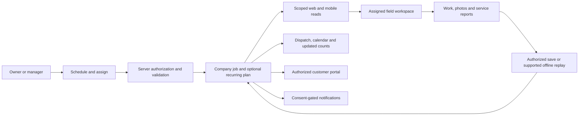

# Route Logistics — Recent Development Summary

**Period:** November 13–15, 2026, Pacific time, with November 12 migration foundations included for context.

**Application release covered:** `c93c992`, published November 15, 2026.

**Applications:** Route Logistics web, iOS and Android.

**Infrastructure:** Existing Firebase project `mi-factotum-field-service`, existing Netlify production site, and existing `main` branch.

This document summarizes the recent features, workflow changes, data flows and verification results. It distinguishes implemented functionality from provider acceptance and physical-device testing. Older roadmap and documentation snapshots contain prerequisites and limitations that subsequent releases have superseded; the status below reflects the later implementation and recorded acceptance evidence.

## 1. What changed overall

Route Logistics has developed from separate administrative and field screens into a connected company workflow:

1. A company owner invites staff with explicitly approved roles.
2. A dispatcher schedules a service property, selects eligible staff and checks calendar conflicts in the same workflow.
3. One-time or recurring appointments produce tenant-scoped jobs and assignments.
4. Technicians, including owners/managers who perform field work, receive their assigned jobs on mobile.
5. Staff read job instructions and record observations, photos, checklists, applications and visit evidence without losing their work when connectivity or dialogs change.
6. Status changes update the web and mobile views through scoped queries rather than requiring a full page refresh.
7. Estimates, invoices, customer access, communications and accounting use their own authorization and delivery/reconciliation flows.
8. Platform administration manages public content independently of company administration.

The recent work also established controlled Stripe test payments, QuickBooks sandbox accounting, real email/SMS/iOS-push delivery checks, a browser acceptance suite and corporate iOS distribution configuration. Live financial processing and broad customer messaging remain restricted.

## 2. Identity, permissions and migration

### Staff authentication and onboarding

- Repaired the first-attempt sign-in failure caused by authorization/claims timing.
- Added password visibility, password recovery, remembered email and email-code sign-in to the web login experience; mobile also supports email-code sign-in.
- Kept customer-portal codes separate from staff/platform sign-in codes, with clearer email subjects and entry points.
- Invitations select a company and approved role. Existing Firebase accounts retain their established passwords; an invitation does not set a new password or automatically accept itself.
- Added explicit verified-email acceptance, expiry, reissue, duplicate prevention and audit records. Reissued invitations retain the canonical membership identity and invalidate superseded links.
- Membership revocation and company/role changes are checked against current server records, including during protected operations and offline replay.

### Role boundaries

The shared capability policy covers company owners, administrators, managers and technicians. Technicians receive assigned field work rather than customer/team/company administration. Managers receive operational tools without automatically receiving ownership, financial or platform privileges. Company administration does not grant platform-administrator access.

Business/company information and services now come from the authorized workspace instead of an unrelated empty personal profile. Assigned-job projections separate dispatcher instructions from technician work notes and protect administrative information.

### Acme migration and legacy retirement

- Normalized legacy customer shapes while preserving original data and migration backups. The original **507 Acme customer records** were checked against preservation fingerprints during migration/certification; this is a preservation baseline, not a claim that later operator-created records cannot increase the total.
- Reconciled legacy invitation candidates separately from active staff. The owner approved five technician roles and preservation of the manager role; the owner retained ownership.
- Repaired pending memberships through the existing invitation mechanism, with backups and audits, without automatically accepting invitations or overwriting valid active access.
- Subsequent use verified an active technician and manager. Acceptance and access verification of every intended migrated account remain a separate final migration sign-off.
- Following the decision to retire mi Factotum, removed **29 independent legacy functions** and **four event triggers**, and paused **four legacy schedules**. This removed obsolete accounting imports/synchronization and other competing execution paths.
- Retained the shared Firebase project, Authentication, Firestore, Storage, secrets, required service identity and historical data. The legacy project name remains an infrastructure identifier; Route Logistics is the active application.

## 3. Scheduling, dispatch and geographic coverage

### Customer and business records

Company setup, service categories, branding, estimate templates and customer management were connected to the authorized company workspace. Customer handling supports legacy name/contact/address/date shapes, stable pagination, CSV import preview, retry/deduplication safeguards and formula-safe export. Missing legacy values are presented neutrally rather than invented. Operational and financial reporting remain capability-scoped.

### Schedule and assign together

- Select the technician while creating a job rather than visiting a second screen afterward.
- Search staff by useful identity information, including profile name and email, instead of ambiguous labels such as “Technician.”
- Check membership, field-work eligibility, temporary availability and calendar overlaps before confirmation; check them again on the server when saving.
- Present alternative quarter-hour slots for conflicts. Selecting an alternative changes the proposed schedule but does not silently save it.
- Standardize appointment time controls on **15-minute increments**.
- Correct date-only Jobs displays so a Pacific service date does not shift to the previous day through UTC conversion.
- Keep modification history and reasons for changes.

Calendar checks cover scheduled work; they do not promise travel time or route feasibility between appointments.

### Recurring appointments

- Support weekly, monthly and quarterly schedules, including selected weekdays and supported calendar-day/nth-weekday patterns.
- Handle shorter months explicitly.
- Save the first job and its recurrence plan together, with retry-safe operation identities.
- Reserve future recurring slots and generate visits through the recurring scheduler.
- Support a preferred technician and an explicit fallback/review policy when future assignment eligibility changes.
- Preserve completed visits and historical records when staff availability, membership or recurrence settings change.

### Keep these staff states distinct

| State | What it controls |
| --- | --- |
| Role/capabilities | Which operations the account may perform |
| Field-work eligibility | Whether the person is offered for new field assignments; office-only staff retain their company role |
| Scheduled availability | Leave, sickness, emergency overrides and overlapping appointments |
| On/Off Duty | Whether the employee has started a work shift |
| Location consent/freshness | Whether a usable authorized position is available |
| Job assignment/service date | Which work appears in the employee's assigned schedule |

Being off duty does not hide an assigned job or automatically make a future appointment unschedulable. Owners/managers can set bounded availability overrides; an emergency override does not reactivate a revoked membership or start GPS sharing on another person's behalf.

### Service property and address workflow

- Default the job property from the selected customer's saved address.
- Lock saved addresses until the operator chooses **Enable Editing**.
- Allow an explicit permanent customer-address update; use a version check and audit record instead of silently overwriting the customer.
- Use Google validation for new/changed addresses and offer suggested corrections.
- Allow authorized internal jobs to save with an address warning when Google cannot confirm the address. Mark geography as unverified and clear stale coordinates.
- Keep known service-area restrictions and future public-request/booking checks enforced on the server. Existing appointments are not retroactively invalidated.
- After a warned save, keep the editor open with **Edit address** and **Done**. A correction updates the same saved job using its latest revision; it does not create another job. Done leaves the saved appointment intact.

### Provider service territories

Company settings now support an operating location, ZIP lists or radius coverage, service-category overrides, coverage preview and an accepting-new-customers toggle. Boundaries remain private unless the provider chooses otherwise. Owners can approve explicit, expiring out-of-area exceptions. Coverage is evaluated against the service property, rather than the billing address or phone's location.

This provides reusable eligibility infrastructure for scheduling and estimates. A public provider marketplace, homeowner discovery and booking experience have not been built.

### Dispatch map and details

- Plot jobs and authorized staff locations, with status colors and bounds fitted to the available points.
- Resolve unmapped service addresses explicitly in cached batches rather than making unnecessary paid lookups.
- Show current duty, temporary availability and location freshness as separate information.
- Put selected job details in a visible side dialog instead of below a growing job list.
- Support daily routes, explicit route calculation/optimization, stop ordering, navigation and revision-checked route saves.

Nearest-staff information is an approximate geographic aid, not a guarantee of availability or driving ETA.

## 4. Mobile experience and field work

### Field and Management modes

Eligible owners/managers can use the same account for their own assigned field work and company operations. Technicians remain in their authorized field experience. The selected mode is remembered locally for that account/company.

Management includes overview counts, team, map and schedule. Tapping **Scheduled jobs** opens that date's scheduled appointments; the other job metrics open their corresponding filters. Individual job cards still open Job Details. Reassignment uses:

**Scheduled jobs → Reassign job → select staff → Check assignment availability → Confirm job assignment.**

The reassignment picker uses the shared JavaScript dialog, keeping errors and confirmation visible. The pre-existing **Management → Team schedule → Reassign job** path remains available.

### Interface and Settings

- Introduced a cleaner glass-inspired mobile design, reusable cards/dialogs and more readable navigation.
- Added locally stored System/Light/Dark appearance preferences.
- Moved **On Duty / Off Duty** into the Home header, with detailed explanation and shift actions in a dialog.
- Formatted Settings phone numbers and collapsed Services and Notification Preferences by default.
- Hid the unimplemented English/Spanish toggle instead of presenting a nonfunctional setting.
- Added Privacy Policy, Terms and an About dialog that reports the installed native version/build for support.
- Added account deletion safeguards: recent authentication, matching full email address, explicit deletion confirmation and handling of unsynchronized work. Company-owner and server authorization checks remain enforced; deletion does not erase retained company service history.

### Job instructions, photos and completion

- Exposed dispatcher notes, such as gate/access instructions, in a read-only **Job instructions** section; technician observations remain separate.
- Reworked Job Details, camera/gallery, child-dialog and completion transitions to avoid overlapping native modal presentations and stale selected-job state.
- Preserve selected photo metadata and local files through cancellation, upload failure and supported offline queuing. Surface queue/retry failures.
- Show explicit completion loading, saved/queued/error feedback and protection against duplicate taps.
- Explain actual unfinished drafts in a visible dialog, with options to keep editing, save supported drafts or explicitly discard unsaved local entries.
- Do not require a chemical/product application, photo, checklist or visit event for every completion. The required work description and server assignment/role checks remain.
- Show manual arrival/departure acknowledgements with completed styling, checkmarks and timestamps. Keep uncertain retries tied to the original operation identity.

### Service templates, reports and estimates

- Added eight versioned service-template foundations, including pest/pool-oriented fields, checklists, readings, units, notes and photos.
- Preserve report versions and checklist revision baselines; a background refresh does not replace an unfinished report.
- Keep product/chemical application records separate from general visit completion.
- Added photo-based estimates with server-calculated totals/tax, private attachments, branded PDF generation, immutable versions and expiring approval links.
- Convert an approved estimate into a scheduled job idempotently. Explicit customer creation/reuse avoids silently overwriting an existing customer.

## 5. Synchronization, offline work and location

### Control-level synchronization

Web and mobile use TanStack React Query for scoped reads. Operational controls normally refresh every **30 seconds**, with foreground/reconnect refresh and targeted invalidation after successful writes. Slower company/report metadata uses longer intervals. Existing notification listeners remain in place.

Keys distinguish project, account, company, role, membership and verification/workspace state. Permission failures hide protected data. Customer-portal and platform-admin queries use independent authorities.

Refreshes update lists, counts and read-only details without reloading the page or replacing open forms. A successful write cancels an older in-flight read so the old response cannot overwrite the committed result. Hidden/background/picker activity pauses normal mobile polling. Polling does not initiate payments, messages, uploads, Google calculations or accounting exports.

Invoice list reads now require a server-confirmed result. A failed connection shows retry feedback rather than treating an empty local cache as proof that the company has no invoices; confirmed data remains visible during a transient refresh failure.

### Durable offline operations

Supported work updates, photos and reports use scoped caches/queues, stable operation IDs, retained files and retry/conflict handling. Replay rechecks current authorization and revisions. Changing accounts or ending a shift does not silently discard acknowledged/pending work. Background app execution is not a prerequisite or a guarantee for ordinary synchronization.

### Shift-based location and service evidence

An explicitly started shift and the employee's permission govern tracking. The owner can configure a target interval of **1, 3 or 5 minutes**. Background location requires its separate native permission/configuration; actual timing depends on the operating system and device state.

Ending a shift, signing out, losing authorization or reaching expiry stops collection. Duty remains distinguishable from missing/stale GPS. Location samples use a separate bounded queue, rather than clearing or mixing with work/photo queues.

Manual arrival, departure and unsuccessful-access records preserve timestamps, notes and GPS evidence when available/permitted; automated proximity observations remain distinguishable. These records support service evidence but do not turn approximate GPS into proof of property access.

## 6. New end-to-end data flows

### Shared operational flow

| Flow | How data now moves |
| --- | --- |
| Staff onboarding | Owner-approved invitation → private hashed invitation identity → verified account accepts → canonical membership/claims → authorized workspace |
| Schedule/recurrence | Customer/service property + chosen staff/time → validation/conflict checks → atomic job/plan save → future reservations/generation → assigned mobile schedule |
| Reassignment | Manager selects an existing job/staff → availability preflight → explicit confirmation → server checks current revision/eligibility → assignment/audit update → affected views refresh |
| Field completion | Assigned job → separate instructions/work drafts/evidence → validated operation or durable supported queue → authorization/idempotency/version checks → canonical completed status → web/mobile counts update |
| Shift/location | Employee starts permitted shift → policy-timed GPS samples → scoped latest position/retention → authorized dispatcher map; visit evidence remains separately recorded |
| Estimate approval | Private estimate/photos → server totals + immutable version/PDF → explicit delivery → expiring version-bound customer approval → one scheduled job |
| Stripe test payment | Authorized invoice + server amount → durable test PaymentIntent → Payment Element → signed Stripe event → idempotent payment history/test status; actual invoice payment state preserved |
| QuickBooks | Owner authorizes own company → private tenant/environment tokens and refresh coordination → reviewed mappings/export → sandbox records and payment reconciliation; webhook-origin acceptance remains outstanding |
| Communications | Authorized event + recipient/purpose consent → private outbox → worker revalidation → provider → signed callback/receipt → delivery/suppression audit |
| Customer access | Email OTP → isolated customer session → active provider associations → selected-provider visits/invoices/shared files → revocation rechecked on access |
| Verified review | Valid completed visit + authorized portal/invitation → one review → optional independent public-display permission → provider response/moderation/audit → publication eligibility checks |
| Public content | Explicit platform-admin grant → private draft/revision/image → preview → deliberate publication → public projection/server-rendered page, metadata and sitemap |

### Important record relationships

| Record group | Responsibility |
| --- | --- |
| `users`, `companies`, `teamMembers` | Identity, company context and live membership authorization |
| `customers`, `jobs`, `servicePlans` | Provider-owned customer data, embedded service-property snapshots, appointments, assignments and recurrence |
| `photos`, `serviceLogs`, `rlJobVisits`, service-form/report records | Private field evidence, applications, visits and versioned reports |
| `rlWorkShifts`, `rlLocations`, `rlStaffAvailability` | Duty, authorized position and temporary/field-work eligibility settings |
| `invoices`, `rlPayments`, `rlPaymentEvents` | Financial documents and auditable payment/test reconciliation |
| `rlQuickBooksConnections`, `rlQbMappings` | Server-only company/environment connection and accounting identities |
| `rlMail`, `rlSmsOutbox`, `rlPushDeliveries` | Delivery work, retries, receipts and history |
| `rlPortalChallenges`, `rlReviews`, `rlPlatformContent` | Isolated OTP challenges, verified feedback and managed website content |

This is a relationship guide, not a complete schema. A shared customer email does not merge providers' source records or grant cross-company access.

## 7. Customer portal, verified feedback and platform CMS

### Customer portal — `/portal`

- Isolated email-OTP session with ten-minute expiry, attempt limits, rate limiting and transactional replay prevention.
- Discover only authorized active provider associations; group duplicate customer rows within a provider without rewriting the underlying records.
- Switch providers while keeping visits, invoices, payment history and file access scoped to the selected provider.
- Show only explicitly shared photos/published service documents; private files are not automatically exposed or assigned permanent public URLs.
- Remove access when an association/provider is revoked, and prevent late requests from restoring a previous provider's data.

### Verified service feedback — `/review`, `/reviews`, and the portal

- Permit feedback only for an authorized completed service, with one review per visit.
- Preserve the customer's rating/comments; providers can respond, record private follow-up notes and moderate with an audit trail.
- Keep public-display permission separate, optional and withdrawable. Permission alone does not publish a review.
- Include negative and hidden feedback in all-submitted rating statistics; exclude synthetic test feedback from publication.
- Implement controlled email/SMS invitation infrastructure without enabling automatic invitations globally. Review SMS needs its own consent purpose.

### Platform administration and public website

`/platform-admin` requires an explicit verified platform-admin grant independent of company roles. It manages FAQs, testimonials and success stories with drafts, preview, publication/archive status, images/alt text, revision checks and audit history.

Public routes include `/faqs`, `/testimonials`, `/success-stories` and individual content pages. Published content has server-rendered readable HTML, editable SEO titles/descriptions, canonical/Open Graph metadata, sitemap entries and appropriate structured data. Draft/unpublished content has restricted/noindex or not-found behavior. Five factual FAQs were published; genuine approved testimonials/stories remain content work. No fictional endorsements or success stories were published.

## 8. External integrations: verified status and limits

| Integration | Actual verified result | Current boundary / remaining acceptance |
| --- | --- | --- |
| SendGrid email | Enabled worker and controlled SMTP delivery; inbox receipt confirmed at the authorized Workside address. Portal OTP delivery/consumption and synthetic review submission were also recorded. | Other recipient systems classified tests as junk/quarantine. SMTP acceptance and inbox placement are separate outcomes. |
| Google Maps | Browser/backend configuration separated; controlled routing/address checks, service eligibility and map presentation implemented and tested. Backend credentials are not sent to browsers. | Avoid unnecessary paid lookups; confirm background/device behavior separately. The Firebase-generated browser key was preserved. |
| Stripe | Matching test keys, Payment Element, server amounts/ownership, genuine signed test callback, replay handling and a $1 simulated payment passed. `testPaymentStatus` changed while the actual invoice remained unpaid. | Test mode only; live payments remain unapproved. No real charge was made. Refund/dispute handling exists but is not a claim of complete live-provider certification. |
| QuickBooks Online | Tenant-owned OAuth connect/disconnect/reconnect, secure refresh coordination, searchable existing income accounts/service items and mapping compatibility. Controlled sandbox customer/invoice/payment certification passed. | Sandbox only; accounting writes were restricted again after testing. No production synchronization enabled. Genuine Intuit webhook delivery remains unverified. |
| Twilio SMS | Existing approved shared toll-free sender delivered authorized RL messages. Dedicated RL send credentials, signed callbacks and genuine handset STOP/START processing passed. | Broad/company-wide automation remains off. The recipient-only pilot expired **November 15 at 11:07 AM Pacific**; it is not currently an active authorization. |
| Native push | Physical iPhone receipt and tapping an authorized follow-up to open its existing assigned job passed. Registration, authorization, receipts and invalidation are implemented. | The test did not create a job. All lifecycle states are not certified; Android FCM setup/delivery remains a separate acceptance item. |

QuickBooks sandbox results included one synthetic customer, two invoices and two nonprocessing payments. The explicit manual 8% tax mapping produced $1.60 tax on $20; separate $5 and $15 payments reconciled the non-taxed $20 invoice from partial to paid in **test reconciliation fields**, while its actual RL invoice remained `sent`. Retry/reconciliation replay did not create duplicates. This certifies that controlled mapping, not arbitrary production tax configurations.

Accounting-default selectors show names/details while storing compatible QuickBooks IDs internally. They handle loading, expired connections, invalid old selections and empty results. An empty service-item list directs the owner to create the item in QuickBooks and refresh; Route Logistics does not automatically create accounts/items in that workflow. Save confirmation, change-only Save enablement and unsaved-navigation warnings were added to these and other editable web workflows.

Intuit's portal displayed sample-event SUCCESS, but a corresponding genuine request was not correlated in the deployed RL logs. Local signature, unknown-realm and idempotency checks do not substitute for that missing origin/delivery evidence. Both portal-sample correlation and genuine sandbox-change delivery remain separate acceptance items.

For SMS, STOP suppresses the recipient for the shared sender and cancels queued RL messages. START may clear provider suppression but **never restores Route Logistics consent**. A separate valid RL opt-in is required. Tenant-specific consent/history and the other application's sender configuration were preserved.

## 9. Release, build and operational improvements

- Kept development on `main`, production Netlify and the existing Firebase project; no staging environment or additional Firebase project was introduced.
- Deployed only affected Route Logistics code; no blanket shared-resource deletion.
- Corrected mobile Firebase configuration so native builds use the real client project configuration without Admin/service-account credentials.
- Aligned Expo SDK 54 / React Native 0.81.5 dependencies and native preparation, including the missing native-module issue.
- Added iOS/Android icon assets and corporate iOS signing/distribution configuration.
- Final iOS identifier: `com.worksidesoftware.routelogisticsapp`; corporate Apple team `AXCZ2G99P6`. Android remains `com.workside.routelogistics`; existing Expo ownership/EAS project identity is preserved.
- Simplified the normal mobile-directory workflow to `eas build --platform ios --auto-submit`, without depending on the earlier project-root/no-VCS overrides.
- Added installed-version/build reporting and documented that changing a bundle identifier creates a separate app container; local queues/photos/preferences do not automatically migrate.
- Expanded ignore rules for secrets, native/build artifacts, browser traces and authentication state.
- Fixed the Netlify scan block caused by a redundant project-ID literal by using configured Firebase values; secret scanning stayed enabled.

Web updates publish through the existing GitHub/Netlify workflow. Installed mobile apps require the appropriate rebuilt release to receive these source changes; this work did not automatically submit a new native build or publish an App Store release.

## 10. Verification and acceptance

| Evidence | Recorded result |
| --- | --- |
| Latest complete web service/UI suite | **406/406 passed** |
| Latest complete mobile suite | **332/332 passed** |
| Earlier broad browser matrix | **105 case/browser combinations verified**: 35 scenarios across Chromium, Firefox and WebKit, including successful focused reruns of the initial failures |
| Latest address-review browser regression | **3/3 passed** across those engines: retained warning, same-job correction, Done, unchanged customer address |
| Recent backend units | 182 passed; one emulator-only case skipped by that unit command |
| Relevant backend emulator work | 80 unique targeted address cases; additional working-role/scheduling/instruction subset 28/28 passed |
| Build checks | Web lint/build passed; iOS and Android bundle exports passed; earlier unchanged-config Expo Doctor check 18/18 passed |
| Latest web publication | `c93c992` confirmed ready on Netlify, with the expected editor changes present in served assets |

These are separate executed snapshots/subsets, not numbers to add into one test total. The previous 105 browser executions and the latest three-case regression do not mean a fresh full 108-case matrix was run on the final release. CI now includes browser smoke coverage and failure artifacts alongside existing automated checks; local evidence is not a claim about an unobserved remote CI run.

Operator feedback confirmed successful sign-in, the redesigned mobile interface, delivery of assigned jobs to mobile, iPhone push receipt/tap navigation, platform-admin login, and the synthetic review workflow. The latest saved-address workflow was also reported working. These confirmations do not replace the remaining structured physical-device acceptance plan.

## 11. Remaining work and intentional restrictions

1. **Physical mobile acceptance:** continue camera/gallery/cancel/reopen, offline retry/restart, completion, shift/background permissions, location evidence, new reassignment dialogs, accessibility and secure deletion checks on the current rebuilt iOS/Android apps.
2. **Android push:** complete/verify the required FCM credential configuration and actual device delivery. Do not infer it from the iPhone result.
3. **QuickBooks webhook:** correlate a genuine Intuit delivery, signature verification, tenant routing and processing; keep production accounting disabled meanwhile.
4. **Financial launch:** live Stripe and production QuickBooks require explicit approval and further controlled acceptance. Existing sandbox/test results are not live authorization.
5. **Messaging launch:** broad SMS and automatic review invitations remain off. Any new pilot needs its own current recipient/purpose/budget authorization and valid consent; the prior SMS pilot has expired.
6. **Migration sign-off:** confirm acceptance/access for every intended migrated staff member before declaring the entire staff migration complete.
7. **Public growth:** obtain genuine approved testimonials/success stories. Marketplace discovery, public coverage search and homeowner bookings remain future work.
8. **Broader roadmap:** full MFA/recovery and remaining operational/performance/reporting work should follow their current acceptance/backlog records; this summary does not declare the entire development roadmap complete.

## 12. Recent release milestones

| Date, Pacific | Major work |
| --- | --- |
| November 12, foundation | Additive migration, membership/invitation infrastructure, tenant security and initial RL integration/offline foundations |
| November 13 | Authentication/RBAC repairs, mobile Firebase/dependencies, dispatch and assigned work, photo/completion lifecycle, mobile redesign/icons, shifts/visit evidence, corporate signing, service reports/photo estimates and simpler EAS workflow |
| November 14 | QuickBooks lifecycle/accounting certification and legacy retirement; verified SMS/iOS push; customer portal/platform CMS/SEO; service territories; verified reviews; Playwright/master acceptance; Jobs Pacific date correction |
| November 15 | Mobile legal/About/deletion controls; address editing/validation and quarter-hour controls; technician/recurring scheduling; dual-mode operations and availability; compact duty header; staff identity/field-work flag; instructions/visit/completion feedback; cross-app synchronization/green dropdowns; saved-address review and mobile scheduled-job shortcuts |

Latest feature commits: `e6ef8eb` scheduling/recurrence, `6eb8bfc` dual-mode/availability, `1167330` field-work eligibility, `542e514` instructions/visit feedback, `fae72aa` scoped synchronization/address warnings, `a005118` configured-project build correction, and `c93c992` retained address review/mobile scheduling shortcut.

## 13. Supporting records

- [Master acceptance plan](ROUTE_LOGISTICS_MASTER_ACCEPTANCE_TEST_PLAN.md)
- [Migration progress](migration-progress.md) — historical snapshots; later acceptance supersedes earlier pending-state descriptions
- [Legacy retirement](legacy-retirement.md)
- [Scheduling and recurrence](SCHEDULING_AND_RECURRENCE.md)
- [Job address editing](JOB_ADDRESS_EDITING.md)
- [Mobile dual-mode operations](mobile-dual-mode-operations.md)
- [On-duty tracking and dispatch](on-duty-tracking-and-dispatch.md)
- [Mobile job workflow repair](mobile-job-workflow-repair.md)
- [Mobile Settings and account deletion](MOBILE_SETTINGS_ACCOUNT_DELETION.md)
- [Corporate iOS signing](ios-corporate-signing.md)
- [Customer portal and platform CMS](customer-portal-platform-cms.md)
- [Customer reviews](customer-reviews.md)
- [Provider service areas](provider-service-areas.md)
- [Communications activation](communications-activation.md)
- [QuickBooks tenant onboarding](quickbooks-tenant-onboarding.md)
- [QuickBooks sandbox certification](quickbooks-sandbox-certification.md)
- [Deployment and Stripe test evidence](deployment.md)

Provider credentials, OTPs, invitation/review tokens, device tokens, private customer data and raw authenticated traces are intentionally excluded. Detailed operational evidence remains in the existing ignored local reports rather than in this summary.
