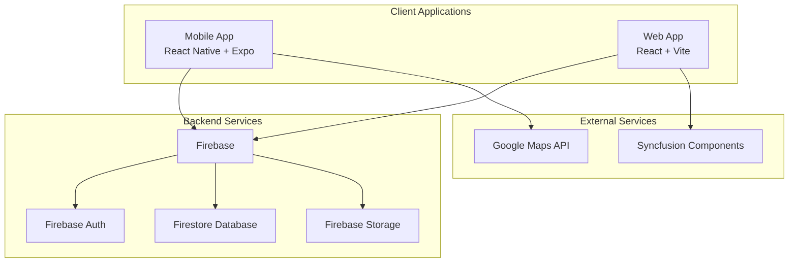

# Route Logistics - Field Service Management Platform

**Version:** 1.0.0  
**Last Updated:** November 12, 2026
**Platform:** React Native (Mobile) + React (Web)  
**Backend:** Firebase (Firestore, Auth, Storage)

## Overview

Route Logistics is a comprehensive field service management platform designed for handyman and field service businesses. The system consists of a mobile app for field technicians and a web dashboard for administrators.

## Architecture



## Quick Start

### Mobile App (React Native)
```bash
cd routeLogisticsMobile
yarn install
yarn start
```

### Web App (React)
```bash
cd routeLogisticsWeb
yarn install
yarn dev
```

## Documentation Structure

- [Migration progress and code review](./migration-progress.md) - Current implementation, Acme audit, verification, deployment status, and remaining work
- [MF-to-RL migration plan](./mf-to-rl-migration-plan.md) - Migration scope and phase status
- [Development roadmap](./development-roadmap.md) - Prioritized backlog and implementation status

- [Architecture](./architecture.md) - System design and technical overview
- [Mobile App](./mobile-app.md) - React Native application documentation
- [Web App](./web-app.md) - React web application documentation
- [API Reference](./api-reference.md) - Firebase services and data models
- [Security](./security.md) - Authentication and authorization
- [Deployment](./deployment.md) - Build and deployment procedures
- [Development](./development.md) - Development setup and guidelines

## Key Features

### Mobile App
- ✅ User authentication and profile management
- ✅ Service category selection and registration
- ✅ Customer management (CRUD operations)
- ✅ Job scheduling and management
- ✅ Estimate creation and templates
- ✅ Multi-language support (English/Spanish)
- ✅ Offline-first data synchronization

### Web App
- ✅ Company setup and configuration
- ✅ Customer management dashboard
- ✅ Estimate template management
- ✅ Job management and tracking
- ✅ Calendar view with Syncfusion components
- ✅ Comprehensive reporting and analytics
- ✅ Team member management

## Technology Stack

### Mobile App
- **Framework:** React Native with Expo
- **State Management:** React Context API
- **Navigation:** React Navigation
- **Backend:** Firebase (Auth, Firestore, Storage)
- **UI Components:** Custom components with responsive design
- **Storage:** AsyncStorage for local persistence

### Web App
- **Framework:** React 19 with Vite
- **State Management:** React Context API + TanStack Query
- **Routing:** React Router DOM
- **Styling:** Tailwind CSS
- **UI Components:** Heroicons + Syncfusion
- **Backend:** Firebase (Auth, Firestore, Storage)
- **Animations:** Framer Motion

## Data Models

### Core Entities
- **Users** - Authentication and profile data
- **Customers** - Client information and contact details
- **Jobs** - Service appointments and work orders
- **Estimates** - Project quotes and pricing
- **Companies** - Business information and settings
- **Team Members** - Staff management
- **Estimate Templates** - Reusable quote templates

## Security

- Firebase Authentication with email/password
- Firestore security rules for data isolation
- User-specific data access controls
- Secure credential storage (Expo SecureStore)

## Development Status

### Completed Features
- ✅ User authentication and registration
- ✅ Mobile app core functionality
- ✅ Web app administrative dashboard
- ✅ Customer and job management
- ✅ Estimate system with templates
- ✅ Calendar integration
- ✅ Reporting and analytics
- ✅ Multi-language support

### TODO: Future Enhancements
- [ ] Push notifications
- [ ] Photo upload and management
- [ ] Invoice generation
- [ ] Payment processing integration
- [ ] Advanced reporting features
- [ ] Mobile app offline sync improvements
- [ ] Customer portal
- [ ] API rate limiting
- [ ] Data export functionality

## Contributing

See [Development Guidelines](./development.md) for setup and contribution instructions.

## License

Private - All rights reserved.
