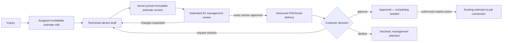

# Route Logistics — Technician Estimates and Customer Approval

Implementation baseline: November 18, 2026. This document describes the bounded technician-to-management-to-customer quotation workflow. It does not certify unperformed physical-device or real-email delivery tests.

## Outcome

Route Logistics now continues an inquiry through a nonbillable estimate visit, an assigned technician's durable quote draft, exact-version management review, secure customer delivery and a customer decision. Approval produces **Approved — scheduling needed**. It does not automatically create a job, invoice, payment or accounting export.

The implementation extends the existing `rlEstimate` and `rlEstimateApproval` contracts. It does not add a second estimate engine, customer database, scheduler or payment path.

## Workflow



## Data relationships

| Record | Batch B role |
| --- | --- |
| `rlInquiries` | Retains the same customer and `servicePropertyId`; advances through `estimate_drafted`, `estimate_approved_scheduling_needed`, `estimate_declined`, `estimate_revision_requested` and explicit `converted`. |
| `jobs` estimate visit | Remains `appointmentKind: estimate_visit` and `billable: false`; supplies the authoritative customer, property, category, inquiry and assignment. `estimateId`/`estimateVersion` link the quote without creating another job. |
| `estimates` | Current server-calculated quote, source visit/inquiry/property references, preparer identity, review state, customer decision and scheduling-needed flag. |
| `rlEstimateVersions` | Immutable saved price/scope/photo snapshots. Management approval and customer decisions are bound to one version. |
| `rlEstimateOperations` | Stable save operation receipt used for retry and duplicate suppression. |
| `rlEstimateTasks` | Deduplicated review and customer-decision/scheduling follow-up tasks. |
| `rlEstimateApprovalSecrets` | Hashed, expiring, recipient-checked, version-bound customer link and single decision state. |
| `rlMail` | Existing versioned PDF email outbox. Queued, provider accepted and inbox delivered remain distinct states. |
| `rlEstimateConversions` | Existing idempotent explicit conversion receipt. Conversion is the only Batch B path that creates a paid-work job. |
| `rlAudit` | Save, review submission, review decision, customer decision and conversion evidence. |

No invoice or payment record is created by drafting, review, delivery, approval, decline or revision request.

## Authorization model

The existing `estimates.manage` capability remains management-only. Technicians receive the narrow `estimates.prepareAssigned` capability.

An assigned technician may:

- open an eligible nonbillable estimate visit assigned to their current active membership;
- create or reopen that visit's deterministic estimate;
- edit drafts/changes-requested versions, attach private photos and submit a saved version; pricing lines are optional at the technician stage;
- read only estimates still linked to their own current assignment;
- return directly to the originating work order after saving or submitting.

A technician cannot change the visit's customer, inquiry or service property, access an unrelated estimate, generate the formal customer PDF, approve or initiate customer delivery, create invoices, or acquire management/financial capabilities. The backend takes visit geometry from the current authorized visit and ignores a technician attempt to substitute or revalidate it.

Owner/admin/manager users complete formal review in the web application. They may inspect field evidence, edit the submitted scope and pricing into a new immutable version, preview/download the customer PDF, approve that exact version, make a one-time recipient correction and explicitly deliver it. The server rejects technician PDF and delivery calls regardless of obsolete stored company settings.

Customer links expose only the public version projection, public photos and PDF. Technician and internal review notes, tenant service-area records and unrelated customer data are excluded.

## Mobile editor and service catalog

Field Job Details shows **Prepare Estimate** or **View Estimate** for an eligible estimate visit. The existing editor is reused in Field Mode; Management Mode also exposes **Quotes**.

The visit binds the customer, property, inquiry and service category. The editor supports scope, optional technician-proposed labor/material/service lines, customer notes, technician notes and private photos. Managers finalize required quantities, unit prices, bounded flat tax and customer-facing descriptions in the web application and additionally see internal review notes.

Active company estimate templates are returned as sanitized values. Choosing one copies its current scope and line prices into the draft. A later catalog edit cannot change an already saved quote or its version snapshot. The flat tax remains an explicit bounded input; Route Logistics does not claim to determine jurisdiction-specific tax.

## Durable offline draft lifecycle

Draft storage uses AsyncStorage and the app document directory. Keys include Firebase project, UID, company, membership, role and estimate/visit identity. Persisted content includes the visit/customer/property references, all quote inputs, stable operation ID, base version, local revision/time, synchronization state and retained photo metadata.

Text changes start a serialized device write immediately and are also persisted after render and when the app backgrounds. Picker files are copied out of temporary storage before the UI reports retention. A local photo is removed only after its upload and attachment have been confirmed or after the user explicitly discards the draft.

State labels are:

- Saved on device
- Waiting to sync
- Synchronizing
- Saved to server
- Needs review
- Failed — retry

Reconnect may synchronize a supported draft, but it never submits for review or sends it to a customer. The server rechecks live membership, assignment, customer/property/visit relationships and expected estimate version. A revision conflict preserves the local draft and requires review; it does not overwrite either side.

## Review and customer decision integrity

**Submit for Review** records the submitted version and one deterministic review task. A management edit creates a new immutable draft version, preserves the technician-submitted snapshot and supersedes its open review task. Management can preview the customer PDF before approval. Approval requires at least one priced line and a valid recipient and records `approvedForDeliveryVersion`; modifying the estimate creates another immutable version and removes that authorization. A changes request includes comments and returns the estimate to the assigned preparer.

Delivery validates live management access, recipient, status and exact version, then reuses the existing private PDF/outbox. The prefilled delivery email may be corrected once for that version without changing the customer record. Retry uses the same versioned mail identity and cannot queue a second delivery or switch recipients.

The secure customer page supports:

- versioned PDF download;
- approval with name and explicit terms acknowledgement;
- decline with an optional reason;
- revision request with required details.

The first valid decision closes that link's decision state. An exact replay returns the prior result; a different decision is rejected. Expired, superseded, wrong-recipient and wrong-version links fail closed.

## Scheduling handoff and financial protection

Customer approval sets `schedulingNeeded: true`, advances the linked inquiry and opens one management task. **Schedule Approved Work** opens the existing estimate conversion/scheduling workflow. Availability, tenant scope and destination customer/property remain server-authoritative.

No Batch B action automatically:

- creates a service job before explicit conversion;
- creates or sends an invoice;
- collects a Stripe payment;
- writes to QuickBooks;
- changes the nonbillable estimate visit into a billable service.

Stripe remains test-only. QuickBooks writes remain disabled and the QuickBooks event processor is not resumed.

## Automated evidence

Executed before release:

| Suite | Result | Scope |
| --- | --- | --- |
| `functions/estimates.test.js` | 4/4 pass | Integer-cent totals, input bounds and local private PDF generation. |
| Focused Firestore estimate emulator | 14/14 pass | Assigned technician boundary, review/version integrity, direct-send policy, customer decisions, recipient/token security, no financial side effects and idempotent conversion. |
| Complete mobile suite | 423/423 pass | Existing mobile regression plus durable quote drafts, photos, restart recovery and estimate UI. |
| Focused mobile estimate/workspace suite | 64/64 pass | Editor, role reachability, direct Job Details handoff, decisions, navigation and draft behavior. |
| Web unit/component suite | 475/475 pass after the deep-link harness correction | Web workflows, role/scope behavior, unsaved drafts and existing application regressions. |
| Functions unit suites | 28/28 guards and 185/185 executed Functions cases pass; one emulator-only case skipped by design | Estimate arithmetic/PDF, authorization helpers and existing provider/financial safety contracts. |
| Intake, estimate/scheduling and invoice emulators | 20/20, 28/28 and 29/29 pass in isolated runs | Existing prospect conversion, estimate appointments and authoritative invoice behavior now exercise the exact-version management approval gate. |
| Playwright browser matrix | 130/135 passed in the initial full Chromium/Firefox/WebKit run; all five affected executions passed after correcting two test-harness assumptions | All 45 browser scenarios executed in each engine. The initial failures were an overly strict invoice-row locator in three engines and asynchronous sign-out races in two Chromium scenarios; focused reruns passed Chromium 3/3, WebKit 1/1 and Firefox 1/1. |
| Web lint/build | Pass | ESLint clean; production Vite build completed. |
| Expo Doctor and native exports | Pass | 18/18 Expo checks; Hermes iOS and Android exports completed locally. |

Emulator transports use controlled invalid recipients and injected providers. No real customer email, SMS, financial transaction or accounting write was performed.

## Production release

Implementation commit `8af151adcbc4e2573e99ba4ec306103a03d8e596` was pushed to the existing `main` branch. Only the affected Route Logistics Functions were deployed to `mi-factotum-field-service`:

| Function | Active revision | Runtime | Source hash |
| --- | --- | --- | --- |
| `rlEstimate` | `rlestimate-00015-qib` | Node.js 22 | `94b6898389665b5b7bdd91c096f0fb91024cf301` |
| `rlEstimateApproval` | `rlestimateapproval-00007-yes` | Node.js 22 | `94b6898389665b5b7bdd91c096f0fb91024cf301` |

Firebase reported two deployed and zero errored functions. No mi Factotum Function, Firestore rule, index, scheduled worker or unrelated Route Logistics Function was deployed.

Netlify deployment `6afbb76afbdc8c884804f099` is ready for the same implementation commit. A read-only production asset check at 6:12 PM Pacific verified the management-review controls, customer decisions, scheduling-needed handoff, Job Details inquiry context and owner direct-send policy. The check performed no production record write.

Production safety gates remained unchanged: Stripe is test mode with live approval off; QuickBooks is sandbox with writes and production approval off; broad SMS remains disabled. No real delivery or financial/accounting transaction was performed during release verification.

## Physical acceptance — not yet passed

- [ ] Android: open assigned estimate visit, create scope/lines/photos offline, terminate and restart, restore exact draft, reconnect, synchronize once and submit.
- [ ] iOS: repeat the durable draft/photo/restart path in a corporate-signed build.
- [ ] Management: open submission, inspect photos/prices/tax, request changes, receive revised version, approve and explicitly send.
- [ ] Customer phone: open the secure link, download the correct PDF and exercise approval, decline and revision on separate synthetic versions.
- [ ] Financial safety: confirm the free visit creates no invoice; customer approval shows scheduling needed and creates neither invoice nor charge.
- [ ] Delivery: confirm a single authorized synthetic message progresses from outbox to provider/inbox evidence without contacting a real customer.

Native source changes require a new Android/iOS build. Installing over the existing app is required to preserve local queues; do not uninstall or clear application data.

### Local Android release artifact

- Gradle task: `android/gradlew assembleRelease`
- Result: pass (575 tasks)
- APK: `routeLogisticsMobile/android/app/build/outputs/apk/release/app-release.apk`
- Size: 77,794,289 bytes
- SHA-256: `A43847C5AC23A04F0385EC03FD9DBB6741C3CDFEC6B1D3D17120A997896B9C6C`

Install this build over the existing signed application. Do not uninstall the current app or clear its data because doing so removes locally retained drafts and pending work.

### Required iOS rebuild on the Mac

From the existing Route Logistics checkout on the Mac, update `main`, install the locked dependencies and validate the configuration before building:

```bash
git switch main
git pull --ff-only
cd routeLogisticsMobile
npm ci
npx expo-doctor
npx expo export --platform ios
eas build --platform ios --auto-submit
```

Keep the existing Expo owner, EAS project ID, corporate Apple team and `com.worksidesoftware.routelogisticsapp` bundle identifier. Configure the existing mobile public Firebase values in the Mac environment; never copy Firebase Admin or service-account credentials into the application. The EAS command creates and submits the corporate store build; it was documented here but was not run during this Windows release. After TestFlight processing, install the update over the existing app and execute the iOS physical checklist above.

## Known limitations

- Draft conflict presentation identifies the conflict and preserves both sides; it does not provide a field-by-field merge editor.
- The service catalog adapter uses current estimate template price fields where present; it does not add a new pricing/tax administration engine.
- Secure-link decisions are implemented; historical quote discovery inside the OTP customer portal is separate future work.
- Management follow-up is an in-app estimate/task state. This batch does not add new real email/SMS/push automation for review tasks.
- Physical restart, native camera/photo and real provider delivery acceptance remain outstanding until the checklist above is executed.
