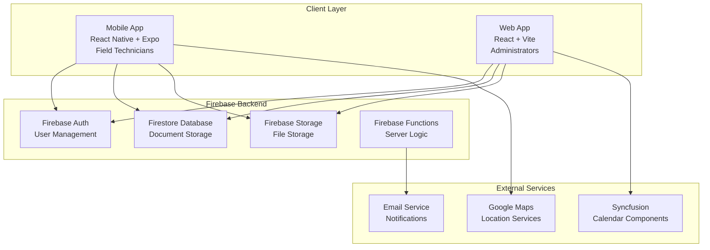
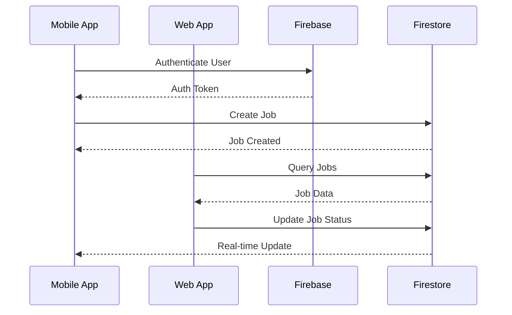
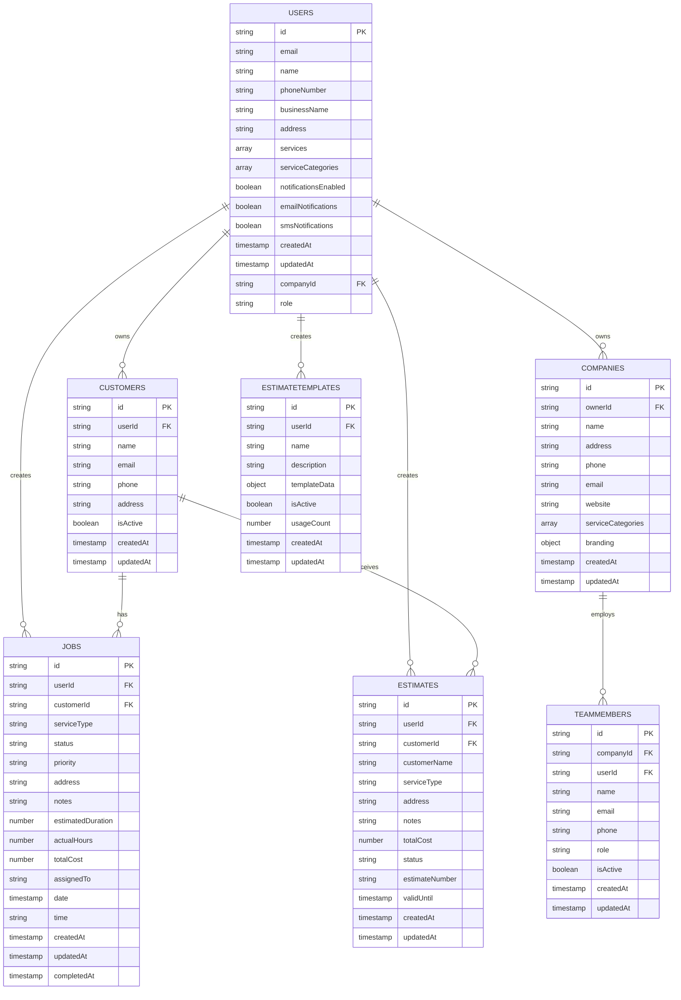

# Architecture Overview

## System Architecture

## Data Flow

## Technology Stack

### Mobile App (routeLogisticsMobile)
- **Framework:** React Native 0.81.5 with Expo SDK 54
- **Language:** JavaScript (ES6+)
- **State Management:** React Context API
- **Navigation:** React Navigation v7
- **Backend Integration:** Firebase SDK v12
- **Local Storage:** AsyncStorage
- **UI Framework:** Custom responsive components
- **Build System:** Expo CLI with EAS Build

### Web App (routeLogisticsWeb)
- **Framework:** React 19.1.1 with Vite 7.1.7
- **Language:** JavaScript (ES6+)
- **State Management:** React Context API + TanStack Query
- **Routing:** React Router DOM v6
- **Styling:** Tailwind CSS v3.4
- **UI Components:** Heroicons + Syncfusion
- **Backend Integration:** Firebase SDK v10
- **Build System:** Vite with modern bundling

### Backend Services
- **Authentication:** Firebase Auth
- **Database:** Firestore (NoSQL document database)
- **Storage:** Firebase Storage
- **Hosting:** Firebase Hosting (web app)
- **Functions:** Firebase Functions (serverless)
- **Security:** Firestore Security Rules

## Data Architecture

### Firestore Collections

## Security Architecture

### Authentication Flow
1. User signs up/in via Firebase Auth
2. JWT token issued and stored securely
3. Token validated on each request
4. User-specific data access enforced

### Authorization Rules
- Users can only access their own data
- Company owners can manage team members
- Firestore security rules enforce data isolation
- No cross-user data access permitted

### Data Protection
- All API calls require authentication
- Sensitive data encrypted in transit
- Local storage uses secure mechanisms
- No sensitive data in client-side code

## Performance Considerations

### Mobile App
- **Offline Support:** Local data caching with AsyncStorage
- **Image Optimization:** Responsive image loading
- **Bundle Size:** Code splitting and lazy loading
- **Memory Management:** Proper component cleanup

### Web App
- **Code Splitting:** Route-based lazy loading
- **Caching:** TanStack Query for API caching
- **Bundle Optimization:** Vite's modern bundling
- **CDN:** Firebase Hosting with global CDN

### Database
- **Indexing:** Composite indexes for complex queries
- **Pagination:** Cursor-based pagination for large datasets
- **Real-time Updates:** Firestore listeners for live data
- **Offline Sync:** Automatic conflict resolution

## Scalability Design

### Horizontal Scaling
- Stateless client applications
- Firebase auto-scales backend services
- CDN distribution for static assets
- Load balancing handled by Firebase

### Data Scaling
- Firestore handles automatic sharding
- Collection-based data organization
- Efficient query patterns
- Batch operations for bulk updates

## Monitoring and Analytics

### Application Monitoring
- Firebase Analytics integration
- Error tracking and reporting
- Performance monitoring
- User behavior analytics

### Business Metrics
- Job completion rates
- Revenue tracking
- Customer satisfaction
- Service type performance

## Development Environment

### Local Development
- Hot reloading for both apps
- Firebase emulators for local testing
- Environment-specific configurations
- Debug tools and logging

### Testing Strategy
- Unit tests for business logic
- Integration tests for Firebase services
- E2E tests for critical user flows
- Manual testing for UI/UX validation

## Deployment Architecture

### Mobile App Deployment
- **Development:** Expo development builds
- **Staging:** EAS Build with staging environment
- **Production:** App Store and Google Play Store
- **OTA Updates:** Expo Updates for JavaScript changes

### Web App Deployment
- **Development:** Local Vite dev server
- **Staging:** Firebase Hosting preview channels
- **Production:** Firebase Hosting with custom domain
- **CI/CD:** Automated builds on git push

## Future Architecture Considerations

### Planned Enhancements
- **Microservices:** Break down monolithic Firebase Functions
- **Caching Layer:** Redis for improved performance
- **Message Queue:** For async job processing
- **API Gateway:** Centralized API management

### Technology Upgrades
- **TypeScript Migration:** Add type safety
- **GraphQL:** More efficient data fetching
- **PWA Features:** Enhanced web app capabilities
- **Real-time Collaboration:** Multi-user editing
