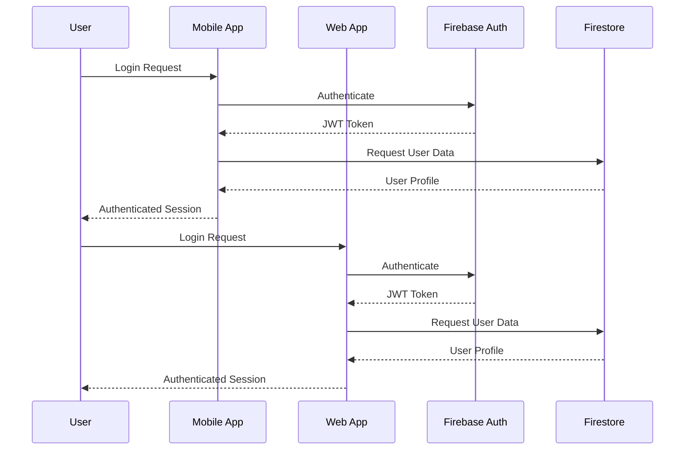

# Security Documentation

## Security Overview

mi Factotum implements a comprehensive security model based on Firebase Authentication and Firestore security rules to ensure data isolation and user privacy.

## Authentication Architecture

### Firebase Authentication
- **Provider**: Email/Password authentication
- **Token Management**: JWT tokens with automatic refresh
- **Session Persistence**: Secure token storage with AsyncStorage (mobile) and browser storage (web)
- **Multi-platform**: Consistent authentication across mobile and web apps

### Authentication Flow


## Data Security Model

### User Isolation
All data is isolated by user ID to prevent cross-user access:

```javascript
// Security rule example
match /customers/{customerId} {
  allow read, write: if request.auth != null && 
    request.auth.uid == resource.data.userId;
}
```

### Collection-Level Security

#### Users Collection
- **Access**: Users can only access their own profile
- **Rule**: `request.auth.uid == userId`
- **Operations**: Read, Write, Update, Delete

#### Customers Collection
- **Access**: Users can only access their own customers
- **Rule**: `request.auth.uid == resource.data.userId`
- **Operations**: CRUD operations restricted to owner

#### Jobs Collection
- **Access**: Users can only access their own jobs
- **Rule**: `request.auth.uid == resource.data.userId`
- **Operations**: Full CRUD with user isolation

#### Estimates Collection
- **Access**: Users can only access their own estimates
- **Rule**: `request.auth.uid == resource.data.userId`
- **Operations**: Full CRUD with user isolation

#### Companies Collection
- **Access**: Company owners can access their company data
- **Rule**: `request.auth.uid == resource.data.ownerId`
- **Operations**: Owner-specific access

#### Team Members Collection
- **Access**: Company owners can manage team members
- **Rule**: Complex rule checking company ownership
- **Operations**: Owner-controlled team management

## Security Rules Implementation

### Complete Firestore Security Rules
```javascript
rules_version = '2';
service cloud.firestore {
  match /databases/{database}/documents {
    // Users collection - users can only access their own data
    match /users/{userId} {
      allow read, write: if request.auth != null && request.auth.uid == userId;
    }
    
    // Customers collection - users can only access their own customers
    match /customers/{customerId} {
      allow read, write: if request.auth != null && 
        request.auth.uid == resource.data.userId;
      allow create: if request.auth != null && 
        request.auth.uid == request.resource.data.userId;
    }
    
    // Jobs collection - users can only access their own jobs
    match /jobs/{jobId} {
      allow read, write: if request.auth != null && 
        request.auth.uid == resource.data.userId;
      allow create: if request.auth != null && 
        request.auth.uid == request.resource.data.userId;
    }
    
    // Appointments collection - users can only access their own appointments
    match /appointments/{appointmentId} {
      allow read, write: if request.auth != null && 
        request.auth.uid == resource.data.userId;
      allow create: if request.auth != null && 
        request.auth.uid == request.resource.data.userId;
    }
    
    // Photos collection - users can only access their own photos
    match /photos/{photoId} {
      allow read, write: if request.auth != null && 
        request.auth.uid == resource.data.userId;
      allow create: if request.auth != null && 
        request.auth.uid == request.resource.data.userId;
    }
    
    // Estimates collection - users can only access their own estimates
    match /estimates/{estimateId} {
      allow read, write: if request.auth != null && 
        request.auth.uid == resource.data.userId;
      allow create: if request.auth != null && 
        request.auth.uid == request.resource.data.userId;
    }
    
    // Companies collection - users can only access their own company
    match /companies/{companyId} {
      allow read, write: if request.auth != null && 
        request.auth.uid == resource.data.ownerId;
      allow create: if request.auth != null && 
        request.auth.uid == request.resource.data.ownerId;
    }
    
    // Team Members collection - users can access if they own the company
    match /teamMembers/{teamMemberId} {
      allow read, write: if request.auth != null && 
        request.auth.uid == get(/databases/$(database)/documents/companies/$(resource.data.companyId)).data.ownerId;
      allow create: if request.auth != null && 
        request.auth.uid == get(/databases/$(database)/documents/companies/$(request.resource.data.companyId)).data.ownerId;
    }
    
    // Estimate Templates collection - users can only access their own templates
    match /estimateTemplates/{templateId} {
      allow read, write: if request.auth != null && 
        request.auth.uid == resource.data.userId;
      allow create: if request.auth != null && 
        request.auth.uid == request.resource.data.userId;
    }
  }
}
```

## Client-Side Security

### Authentication State Management
```javascript
// Mobile App - AuthContext.js
const AuthContext = createContext();

export const AuthProvider = ({ children }) => {
  const [currentUser, setCurrentUser] = useState(null);
  const [userProfile, setUserProfile] = useState(null);
  const [loading, setLoading] = useState(true);

  // Authentication state management
  useEffect(() => {
    const unsubscribe = onAuthStateChanged(auth, async (user) => {
      setCurrentUser(user);
      if (user) {
        // Fetch user profile
        const userDoc = await getDoc(doc(db, 'users', user.uid));
        if (userDoc.exists()) {
          setUserProfile(userDoc.data());
        }
      } else {
        setUserProfile(null);
      }
      setLoading(false);
    });
    return unsubscribe;
  }, []);
};
```

### Route Protection
```javascript
// Web App - ProtectedRoute.jsx
const ProtectedRoute = ({ children }) => {
  const { currentUser, loading } = useAuth();
  
  if (loading) {
    return <LoadingSpinner />;
  }
  
  if (!currentUser) {
    return <Navigate to="/login" replace />;
  }
  
  return children;
};
```

### Secure Data Access
```javascript
// Service layer security
class CustomerService {
  static getCurrentUserId() {
    const user = auth.currentUser;
    if (!user) {
      throw new Error('No user is currently signed in');
    }
    return user.uid;
  }
  
  static async getCustomers() {
    try {
      const userId = this.getCurrentUserId();
      const q = query(
        collection(db, 'customers'),
        where('userId', '==', userId)
      );
      // ... rest of implementation
    } catch (error) {
      console.error('Error getting customers:', error);
      return { success: false, error: error.message };
    }
  }
}
```

## Data Validation

### Input Validation
- **Client-side**: Form validation with error messages
- **Server-side**: Firestore security rules validation
- **Type checking**: JavaScript type validation
- **Sanitization**: Input sanitization for XSS prevention

### Data Integrity
- **Required fields**: Enforced at database level
- **Data types**: Consistent data type enforcement
- **Relationships**: Foreign key validation
- **Constraints**: Business rule enforcement

## Error Handling Security

### Secure Error Messages
```javascript
// Authentication error handling
const signin = async (email, password) => {
  try {
    const userCredential = await signInWithEmailAndPassword(auth, email, password);
    return { success: true, user: userCredential.user };
  } catch (error) {
    // Provide user-friendly error messages without exposing sensitive data
    let errorMessage = 'Unable to sign in. Please check your credentials and try again.';
    
    switch (error.code) {
      case 'auth/user-not-found':
      case 'auth/wrong-password':
      case 'auth/invalid-credential':
        errorMessage = 'Incorrect email or password. Please check your credentials and try again.';
        break;
      case 'auth/invalid-email':
        errorMessage = 'Please enter a valid email address.';
        break;
      case 'auth/too-many-requests':
        errorMessage = 'Too many failed attempts. Please try again later.';
        break;
    }
    
    return { success: false, error: errorMessage };
  }
};
```

### Error Logging
- **Client errors**: Logged to console in development
- **Server errors**: Firebase error reporting
- **Sensitive data**: Never logged in error messages
- **User feedback**: Generic error messages for users

## Network Security

### HTTPS Enforcement
- **Web App**: HTTPS required for all connections
- **Mobile App**: HTTPS for all API calls
- **Firebase**: All connections encrypted
- **CDN**: Secure content delivery

### API Security
- **Authentication**: Required for all API calls
- **Authorization**: User-specific data access
- **Rate limiting**: Firebase-imposed limits
- **CORS**: Proper cross-origin configuration

## Storage Security

### Firebase Storage
- **Access control**: User-specific file access
- **File validation**: Type and size restrictions
- **Virus scanning**: Firebase security features
- **Encryption**: Data encrypted at rest and in transit

### Local Storage
- **Mobile**: Expo SecureStore for sensitive data
- **Web**: Browser localStorage for non-sensitive data
- **Encryption**: Automatic encryption for secure storage
- **Cleanup**: Proper data cleanup on logout

## Security Best Practices

### Code Security
- **No hardcoded secrets**: Environment variables for sensitive data
- **Input sanitization**: All user inputs sanitized
- **SQL injection prevention**: NoSQL database with parameterized queries
- **XSS prevention**: Proper output encoding

### Authentication Best Practices
- **Strong passwords**: Firebase password requirements
- **Session management**: Proper token handling
- **Logout security**: Complete session cleanup
- **Multi-factor authentication**: TODO: Implement MFA

### Data Protection
- **Encryption**: Data encrypted in transit and at rest
- **Backup security**: Encrypted backups
- **Data retention**: Proper data lifecycle management
- **Privacy compliance**: User data protection

## Security Monitoring

### Authentication Monitoring
- **Failed login attempts**: Tracked and rate-limited
- **Suspicious activity**: Firebase security monitoring
- **Session anomalies**: Unusual access patterns
- **Account lockouts**: Automatic security measures

### Data Access Monitoring
- **Access logs**: Firestore access logging
- **Permission changes**: Tracked in audit logs
- **Data modifications**: Change tracking
- **Security violations**: Alert system

## Compliance Considerations

### Data Privacy
- **User consent**: Clear privacy policy
- **Data minimization**: Only collect necessary data
- **Right to deletion**: User data deletion capability
- **Data portability**: Export user data

### Industry Standards
- **GDPR compliance**: European data protection
- **CCPA compliance**: California privacy rights
- **SOC 2**: Security and availability controls
- **ISO 27001**: Information security management

## Security Incident Response

### Incident Detection
- **Automated monitoring**: Real-time security monitoring
- **Alert systems**: Immediate notification of security events
- **Log analysis**: Comprehensive log analysis
- **Threat detection**: Advanced threat detection

### Response Procedures
1. **Immediate containment**: Isolate affected systems
2. **Assessment**: Evaluate scope and impact
3. **Notification**: Inform relevant stakeholders
4. **Recovery**: Restore normal operations
5. **Post-incident**: Review and improve security

## Security Testing

### Penetration Testing
- **Regular testing**: Quarterly security assessments
- **Vulnerability scanning**: Automated vulnerability detection
- **Code review**: Security-focused code reviews
- **Dependency scanning**: Third-party security scanning

### Security Audits
- **Internal audits**: Regular internal security reviews
- **External audits**: Third-party security assessments
- **Compliance audits**: Regulatory compliance verification
- **Risk assessments**: Regular risk evaluations

## Future Security Enhancements

### Planned Security Features
- [ ] Multi-factor authentication (MFA)
- [ ] Role-based access control (RBAC)
- [ ] API rate limiting
- [ ] Advanced threat detection
- [ ] Security audit logging
- [ ] Data encryption at application level
- [ ] Secure file upload validation
- [ ] Session management improvements

### Security Roadmap
- **Q1 2025**: MFA implementation
- **Q2 2025**: Advanced RBAC
- **Q3 2025**: Security monitoring dashboard
- **Q4 2025**: Compliance certification preparation

## Security model (P0 hardening)
- Canonical rules: `firestore.rules` and `storage.rules` (root). Tests: `npm run test:rules`, `npm run test:functions`, `npm run test:e2e`.
- Tenancy via custom claims (`companyId`, `role`) minted by the `syncClaims` Cloud Function; users cannot self-assign roles.
- Invites need a verified email. Config comes from `VITE_*` env vars (see `routeLogisticsWeb/.env.example`).
- Deploy functions: `firebase deploy --only functions` (needs Service Account User role).
- The Support Console / Merxus backend is not part of this repository.

